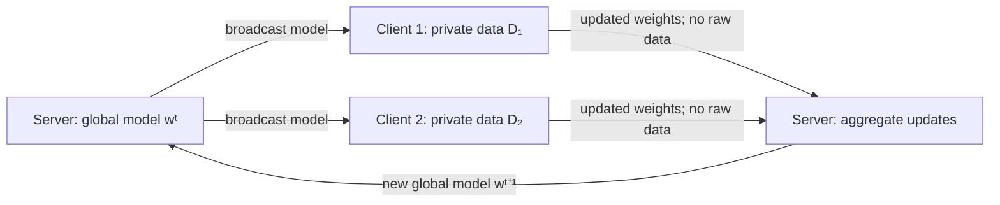
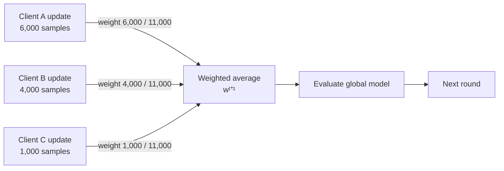
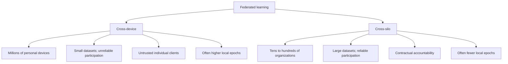
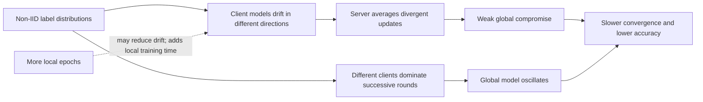
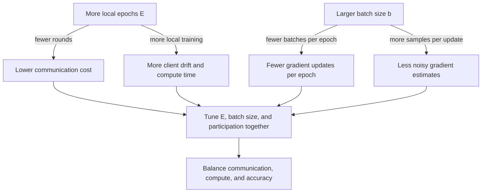

# 29 — Federated Learning Fundamentals

## Abstract

Federated Learning distributes model training across clients while keeping raw data private on each client's device. This lesson introduces the Federated Averaging (FedAvg) algorithm, the core baseline for federated systems, and explores how data distribution and communication trade-offs affect convergence. Students implement a FedAvg simulation using the Flower framework to observe training dynamics on both IID and non-IID datasets.

## Objectives

- State the FedAvg algorithm step by step, including round structure, local training, weighted averaging, and convergence criteria.
- Distinguish cross-device federated learning from cross-silo federated learning by scale, trust model, and data quantity per client.
- Implement a FedAvg simulation using Flower with configurable numbers of virtual clients, local epochs, and participation fraction.
- Explain why non-IID label skew degrades FedAvg convergence and quantify the accuracy gap versus IID training on a fixed dataset.

## Content

### Federated Learning Setting

Smartphone users generate text data every time they type on a keyboard. A central server could collect all typing samples to train a word-prediction model, but users object to sharing their typing patterns with any company. Federated Learning inverts this flow: instead of sending raw data to the server, each client keeps its data private and sends only model updates back.

The FL setting works as follows. Each client holds a dataset $D_k$ that never leaves the device. A server maintains a global model $w^t$ at round $t$. Each round proceeds in three steps: (1) server broadcasts $w^t$ to a subset of clients, (2) clients train locally and compute model updates, (3) clients send only the updates (weights or gradients) back to the server, not the raw data. The server aggregates updates and computes a new global model.



Privacy intuition follows from this architecture. The server observes only aggregated model updates, not individual samples. If a client updates weights based on 1000 private messages, the server sees a weight vector, not those messages. This is not a formal privacy guarantee, yet this approach forms the foundation of the FL privacy model. A curious analyst would need to reconstruct the private data by inverting the model update, which is the subject of m30.

Key terminology: the global model is the authoritative model shared across all clients. A local model is the client's private copy, trained on its own data. A round is one pass of the broadcast-train-aggregate loop. Client participation fraction $C$ is the fraction of clients selected in each round (e.g., $C=1.0$ means all clients participate, $C=0.1$ means 10 percent participate). This controls communication cost versus convergence speed.

Practical motivation comes from regulation and data sensitivity. The European Union's GDPR penalizes companies that centralize personal data. Healthcare systems must comply with HIPAA, which restricts data transfer across institutional boundaries. Financial institutions cannot pool customer transaction logs across branches without legal risk. Federated Learning addresses these constraints by eliminating the need to centralize raw data.

Example: A keyboard app operates on 5 million smartphones. Centralizing typing data would require shipping terabytes of personal text to servers. Instead, FL trains a model entirely on-device. Each smartphone runs a training step using only its user's typing history, computes an update to the word-prediction model, and uploads only the updated weights, typically a few megabytes. The server aggregates these weights from thousands of phones and broadcasts the new global model back. The entire system respects user privacy while improving the model.

### Federated Averaging (FedAvg) Algorithm

FedAvg is the baseline federated learning algorithm. Here is the pseudocode:

1. Server initializes global model $w^0$ randomly.
2. For each round $t = 0, 1, 2, \ldots$:
   - Server samples a fraction $C$ of clients (e.g., 10 out of 100).
   - Server broadcasts $w^t$ to sampled clients.
   - Each client $k$ receives $w^t$, trains it on its own data for $E$ local epochs, and computes updated weights $w_k^{t+1}$.
   - Each client $k$ sends $w_k^{t+1}$ back to the server.
   - Server computes the weighted average: $w^{t+1} = \sum_k \frac{n_k}{n} w_k^{t+1}$, where $n_k$ is the number of samples on client $k$ and $n = \sum_k n_k$ is the total number of samples across all clients.
3. Server evaluates $w^{t+1}$ on a held-out test set and logs the loss or accuracy.

The weighted average gives more influence to clients with more data. If one hospital has 100,000 patient records and another has 1,000, the first hospital's model update is weighted 100 times more heavily, which is statistically sound.

Walkthrough: Consider a three-client example. Client A has 6000 CIFAR-10 samples. Client B has 4000 samples. Client C has 1000 samples. Total $n = 11,000$ samples. In round $t$, all three clients receive the global model $w^t$. Client A trains on its 6000 samples for 2 epochs, producing updated weights $w_A^{t+1}$. Client B produces $w_B^{t+1}$ from 4000 samples, and Client C produces $w_C^{t+1}$ from 1000 samples. The server computes the weighted average: $w^{t+1} = \frac{6000}{11000} w_A^{t+1} + \frac{4000}{11000} w_B^{t+1} + \frac{1000}{11000} w_C^{t+1}$. Client A's update has weight 0.545 (roughly 6 times Client C's weight of 0.091). This reflects the statistical reality that a model update from 6000 samples is more reliable than one from 1000.



Two hyperparameters control the convergence and communication trade-off. Local epochs $E$ is the number of gradient descent passes each client performs on its local data before sending an update. Higher $E$ reduces communication rounds but increases client drift, the divergence of each client's model from the global model. Client participation fraction $C$ determines how many clients participate in each round. Lower $C$ reduces communication load but slows convergence because fewer updates are averaged.

Example: Suppose 100 clients exist, and each round requires uploading a 50 MB model. If $C=1.0$ (all participate), the total upload bandwidth per round is 5 GB. If $C=0.1$ (10 percent), the total is 500 MB. Lower $C$ saves bandwidth immediately, but it also means each client trains locally for longer before seeing an update, which can reduce convergence speed.

Convergence in FL is measured by plotting the global loss or accuracy versus the number of rounds. Compared to centralized training on all data pooled in one location, FedAvg converges more slowly (more rounds) because each round processes only a fraction of the total data. However, FedAvg uses roughly the same total number of gradient updates if communication rounds and local epochs are tuned carefully. For example, centralized SGD on 10 million samples with batch size 32 requires about 312,500 gradient updates to reach a fixed accuracy. FedAvg with 100 clients, each holding 100,000 samples, running 2 local epochs per round for 100 rounds, performs 100 clients × 2 epochs × (100,000 / 32) ≈ 625,000 gradient updates, which is roughly twice the centralized cost. The extra cost reflects the overhead of distributed training.

### Cross-Device versus Cross-Silo Federated Learning

Cross-device federated learning operates on millions of personal devices. Mobile phones, smartwatches, and personal computers each hold a small amount of user data. A smartphone keyboard app learns from typing behavior across millions of users. Individual devices are unreliable: they may go offline, run out of battery, or switch networks. Each device holds perhaps kilobytes to megabytes of data.

Example of cross-device scale: Google Gboard (the mobile keyboard app) has over 1 billion active users. Each user generates roughly 1 to 10 kilobytes of typing data per week. Centralizing this data would require petabytes of storage and raises regulatory concerns. FL lets Gboard train on-device: each phone learns to predict the next word from that user's typing patterns, uploads only the model update (a few megabytes), and discards local data after each round.

Cross-silo federated learning operates on tens to hundreds of organizations. Hospitals form a consortium to train a model for patient outcome prediction. Banks collaborate to detect fraud. Each organization holds gigabytes of sensitive data that it cannot share due to regulation. Organizations are reliable: they participate consistently, have stable connectivity, and often have high-performance infrastructure.

Example of cross-silo scale: A healthcare consortium comprises 10 hospitals, each holding 100,000 patient records. Pooling this data requires HIPAA waivers and legal agreements that hospitals often refuse to grant. FL allows each hospital to train locally on 100,000 records, upload the weight updates, and combine them into a shared model without ever sharing raw patient data. Each hospital's compute infrastructure (often on-premises or in a dedicated cloud region) handles the training load independently.

Trust assumptions differ sharply. In cross-device FL, any individual client may be malicious. An attacker could install a custom app on a smartphone to poison the aggregation by sending bad updates. The server cannot trust any single client. In cross-silo FL, participants are contractually accountable organizations with legal agreements. Byzantine attacks are less likely but still possible.

Data quantity per client drives algorithm design. Cross-device clients contribute tiny amounts of data, so they must train for multiple local epochs (high $E$, e.g., $E=10$) to extract signal from their data before communication. Cross-silo clients hold large datasets, so fewer local epochs (low $E$, e.g., $E=1$) make sense because communication is expensive relative to local compute.



### Non-IID Data Distribution

Standard machine learning assumes that all training samples are drawn independently from the same distribution. In federated learning, this assumption breaks down. Each client has a different local dataset, often with different label distributions or feature distributions.

Label skew occurs when different clients see different subsets of classes. Suppose a keyboard prediction app trains across 1000 smartphones. User A is English-speaking and types 25,000 English words. User B is German-speaking and types 25,000 German words. A centralized model trained on all 50,000 words would learn both languages well. But user A's local model sees only English and develops weak representations for German characters. When models aggregate, the German representations are lost or weakened.

Quantifying label skew uses a Dirichlet distribution. Each client samples a label distribution from Dirichlet($\alpha$) where $\alpha$ is a concentration parameter. When $\alpha = 1.0$, each client sees all classes equally (IID). When $\alpha = 0.1$, label distribution is highly skewed: each client sees only 2 to 3 classes out of a possible 10. This models realistic scenarios where users have different interests.

Concrete example with CIFAR-10: Suppose 100 clients exist. In the IID setting, each client receives 500 training images. Each client's 500 images contain all 10 classes equally (50 images per class). In the non-IID setting with Dirichlet($\alpha=0.1$), client A's 500 images contain 300 dogs and 200 trucks (only 2 classes), while client B's 500 images contain 250 ships and 250 planes (2 different classes), and client C's 500 images contain 100 trucks, 150 horses, 100 deer, and 50 birds (4 classes). When these models aggregate, the global model receives contradictory updates: client A pushes to optimize for dogs and trucks, client B for ships and planes. The aggregated model becomes a weak compromise.

Non-IID data degrades FedAvg convergence for two reasons. First, client drift increases. If each client trains on its own skewed distribution, its local model diverges from the global model. When the server averages updates, it averages a collection of divergent models, and the result is a weak compromise. Second, the aggregated model oscillates. On round $t$, clients with class-A data improve accuracy on class-A examples. On round $t+1$, clients with class-B data pull the model toward class-B. The global model oscillates instead of converging smoothly.

Empirically, the accuracy gap between IID and non-IID training grows as label skew increases. On CIFAR-10 with IID data, FedAvg achieves 85 percent accuracy after 20 rounds. With Dirichlet($\alpha=0.1$) label skew, the same 20 rounds achieve 72 percent accuracy, a 13-point gap. This gap narrows as $E$ increases because more local training on divergent distributions reduces client drift, but the trade-off is higher communication cost. For example, increasing $E$ from 1 to 5 epochs per round might reduce the accuracy gap from 13 points to 5 points, but it also means each client trains 5 times longer before uploading, which increases total training time significantly.



### Communication Rounds, Local Epochs, and Batch Size

Federated learning systems face a hard constraint: communication is expensive. Uploading a neural network's weights takes seconds to minutes on a mobile network. A round of FL must choose how many clients to activate, how long each client should train, and what batch size to use during local training.

The communication-convergence trade-off can be formalized. Let $T$ be the total number of rounds in a training job. Each round activates $C \cdot K$ clients, where $K$ is the total number of clients. Each client runs $E$ local epochs. The total number of gradient updates performed is roughly $C \cdot K \cdot E \cdot \tau \cdot T$, where $\tau$ is the number of batches processed per epoch. To hit a fixed accuracy target, FL algorithms must perform a minimum number of gradient updates. If $E$ is large, fewer rounds are needed, so communication is reduced. If $E$ is small, more rounds are needed.

Batch size determines $\tau$, the number of gradient updates per epoch. If a client has $n_k$ local samples and uses batch size $b$, then $\tau = \lceil n_k / b \rceil$. Batch size affects both convergence speed and the noise in gradient updates. Larger batch sizes (e.g., $b = 128$) reduce noise but require more samples to complete an epoch. Smaller batch sizes (e.g., $b = 32$) introduce noise that can help escape local minima but may require more epochs to converge.

Worked example: Client A has 6000 local samples. With batch size 32, each epoch performs $\lceil 6000 / 32 \rceil = 188$ gradient updates. With batch size 128, each epoch performs $\lceil 6000 / 128 \rceil = 47$ gradient updates. If the client trains for $E=2$ epochs, batch size 32 yields 376 gradient updates, while batch size 128 yields 94. The convergence behavior differs: batch 32 updates the model more frequently (smaller steps), while batch 128 updates less frequently but each update uses more stable gradient estimates. In practice, FedAvg often uses batch size 32 or 64 as a balance.

In cross-device settings, communication rounds dominate the cost. A typical round requires hundreds of megabytes of aggregated model updates. So practitioners set $E$ high (5 to 10 epochs per round) and accept higher client drift. Batch size is usually fixed small (32) because clients have limited data. In cross-silo settings, compute is more expensive than communication, so practitioners set $E$ low (1 to 2 epochs per round) and run more rounds. Batch size may be set larger (64 or 128) because organizations have abundant data.

The trade-off between $E$ and batch size is subtle. Increasing $E$ reduces communication rounds but increases training time on each client. Increasing batch size reduces the number of gradient updates per epoch, which can slow convergence per update, but each update is more stable. Practitioners tune both parameters jointly to balance communication cost, compute time, and final accuracy.



### Flower Framework

Flower (flwr) is a Python framework for federated learning. It provides abstractions for server strategy, client logic, and round orchestration.

A Flower server runs the aggregation loop. The server instantiates a strategy object, typically `FedAvg`, which encapsulates the weighted averaging logic. The server calls `start_server()` and specifies the strategy, the number of rounds, and configuration for client sampling and timeout.

A Flower client implements the `NumPyClient` interface. The client defines two methods: `fit(parameters, config)` and `evaluate(parameters, config)`. The `fit()` method receives the global model as a list of NumPy arrays, trains on the client's local data for $E$ epochs (set via `config`), and returns the updated weights. The `evaluate()` method receives the global model, runs validation on the client's local test split, and returns the loss and accuracy.

Code sketch: A Flower server for 3 rounds with 10 virtual clients might look like:

```python
strategy = fl.server.strategy.FedAvg(
    fraction_fit=1.0,  # All clients participate
    fraction_evaluate=1.0,
    min_fit_clients=10,
    min_available_clients=10
)
fl.server.start_server(
    server_address="[::]:8080",
    strategy=strategy,
    config=fl.server.ServerConfig(num_rounds=3)
)
```

On the client side, a Flower client that trains a neural network for 2 epochs might look like:

```python
class MyClient(fl.client.NumPyClient):
    def fit(self, parameters, config):
        self.model.set_weights(parameters)
        self.model.fit(self.x_train, self.y_train, epochs=config['local_epochs'], batch_size=32, verbose=0)
        return self.model.get_weights(), len(self.x_train), {}

    def evaluate(self, parameters, config):
        self.model.set_weights(parameters)
        loss, accuracy = self.model.evaluate(self.x_test, self.y_test)
        return loss, len(self.x_test), {"accuracy": accuracy}
```

Flower handles the mechanics of broadcasting, aggregating, and round orchestration. The developer writes only the client logic and specifies the number of rounds and strategy. Flower manages the communication loop and synchronization. This abstraction hides the complexity of distributed training and lets practitioners focus on the learning algorithm.

## Lab

See [lab.ipynb](./lab.ipynb). The lab implements a FedAvg simulation with Flower on MNIST, comparing IID and non-IID data distributions to measure the effect of label skew on convergence.

## Summary

Federated Learning enables training on distributed private data by aggregating model updates instead of centralizing raw data. FedAvg is the baseline algorithm: each round, clients download the global model, train locally, and upload updated weights, which the server averages. Cross-device and cross-silo settings differ in scale, trust, and data quantity, requiring different hyperparameter choices. Non-IID data, especially label skew, degrades convergence because client models diverge and the global model oscillates. Batch size affects convergence through the number of gradient updates per epoch, and practitioners tune batch size alongside local epochs and participation fraction to balance communication, compute, and accuracy. Flower provides a practical framework to simulate and deploy federated algorithms with minimal boilerplate.

## Useful References and Resources

- Bonawitz, K., et al. (2019). "Towards Federated Learning at Scale: System Design." Proceedings of MLSys. Defines the FedAvg algorithm and cross-device architecture used in production systems.
- McMahan, H. B., et al. (2017). "Communication-Efficient Learning of Deep Networks from Decentralized Data." ICML. Original FedAvg paper, introduces weighted averaging and proves convergence bounds under IID data.
- Zhao, Y., Li, M., Lai, L., Suda, N., Civin, D., and Chandra, V. (2018). "Federated Learning with Non-IID Data." arXiv:1806.00582. Quantifies the accuracy gap between IID and non-IID FL and proposes FedProx.
- Flower Framework Documentation. <https://flower.ai/docs>. Official Flower API reference and tutorial for NumPyClient and server strategy.
- TensorFlow Federated. <https://www.tensorflow.org/federated>. Alternative framework for federated learning with simulation and deployment examples.
