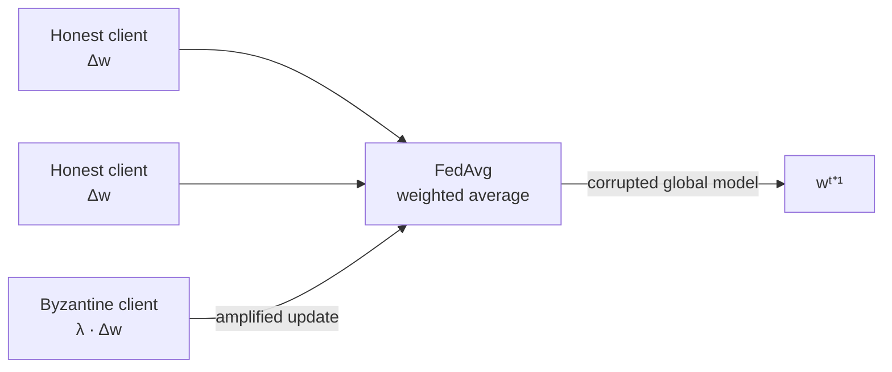
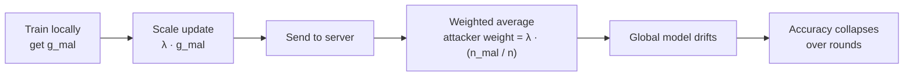
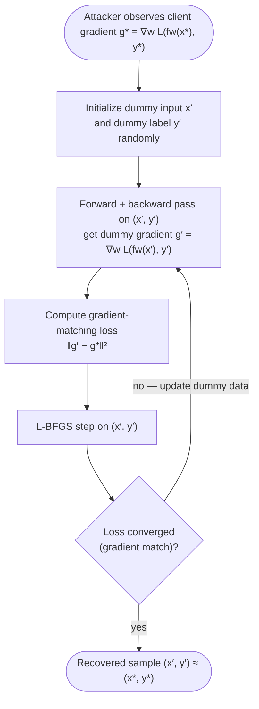
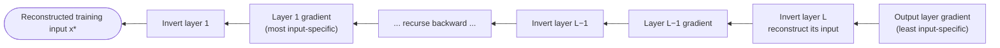
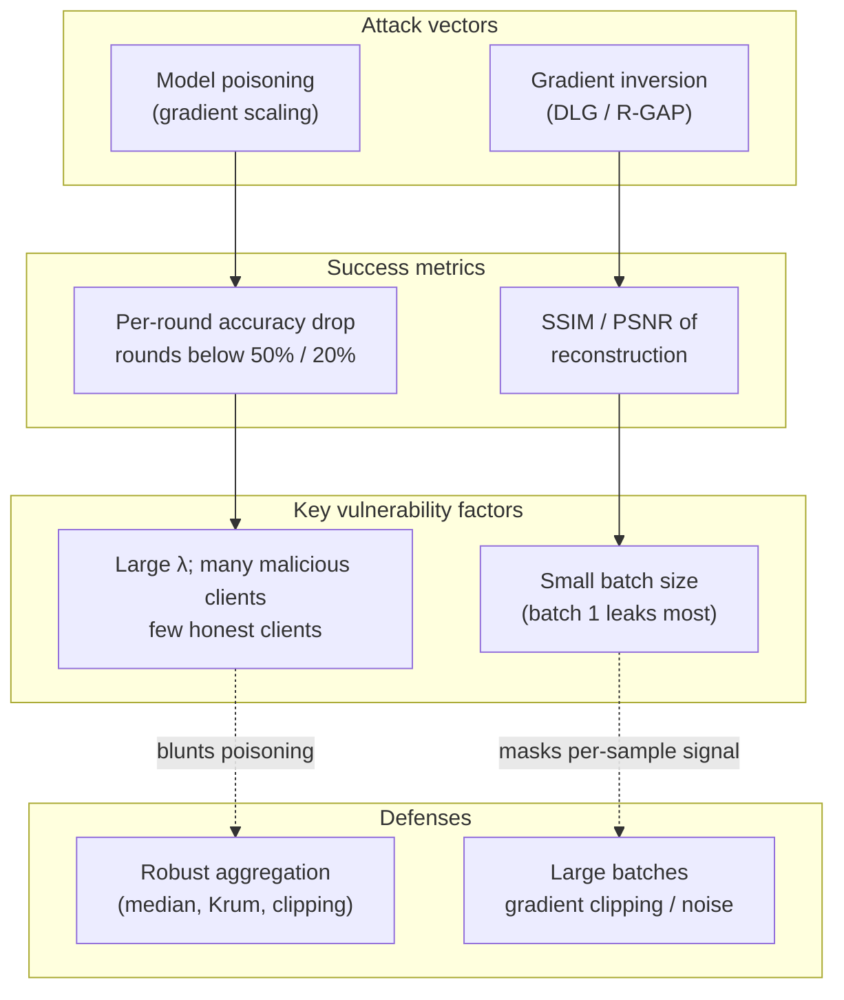

# 30 — Attacks on Federated Learning

## Abstract

Federated learning assumes all clients cooperate honestly, but a single compromised client can poison the global model through gradient scaling or extract training data through gradient inversion. This lesson demonstrates two fundamental attack vectors against FL systems: model poisoning that corrupts accuracy and gradient inversion that leaks private training data. Students measure attack effectiveness using real simulations and learn why standard averaging provides no defense against Byzantine participants.

## Objectives

- Student can state the Byzantine fault model for federated learning and explain why FedAvg has no fault-tolerance guarantee.
- Student can implement a malicious Flower client that scales its gradient update by a configurable factor and measure the resulting global accuracy degradation.
- Student can explain the DLG gradient inversion attack mechanics: what the attacker optimizes, what inputs are required, and under what conditions reconstruction succeeds.
- Student can relate batch size to gradient inversion success rate and articulate why single-sample gradients are maximally exploitable.

## Content

### Byzantine Fault Model in Distributed Learning

A Byzantine participant in a distributed system can deviate arbitrarily from the protocol. In federated learning, a Byzantine client might send random values, scaled values, or adversarially crafted updates instead of legitimate gradients. The classical Byzantine fault tolerance result from Lamport et al. establishes that a system of $n$ nodes can tolerate up to $f$ Byzantine faults only if $n \geq 3f + 1$ (for nodes communicating with unauthenticated "oral" messages). For a 10-client FL system with one Byzantine client ($f = 1$), this requires at least $3(1) + 1 = 4$ total nodes, which is satisfied. However, FedAvg provides no fault-tolerance guarantee because it computes a simple weighted average of client updates. A single malicious client with a large enough update can shift the average arbitrarily, regardless of how many honest clients participate. The averaging operation treats all client gradients equally (up to a weighting factor based on local dataset size), making no distinction between honest and corrupted updates.

### Model Poisoning via Gradient Scaling

A straightforward model-poisoning attack scales the malicious client's gradient update by a large factor before submission. Suppose a malicious client computes its legitimate gradient $`g_{\mathrm{mal}}`$ from its local data. Instead of sending $`g_{\mathrm{mal}}`$, it sends $`\lambda \cdot g_{\mathrm{mal}}`$ where $\lambda$ is a scale factor much greater than 1. The FedAvg update rule aggregates client weights as $`w^{t+1} = \sum_k \frac{n_k}{n} \Delta w_k^{t}`$, where $`n_k`$ is the dataset size of client $k$ and $n$ is the total number of samples across all clients. When one client scales its update by $\lambda = 50$ and that client represents 10% of the total data ($`\frac{n_{\mathrm{mal}}}{n} = 0.1`$), its effective contribution to the aggregate becomes $0.1 \times 50 = 5$ times a normal honest client's contribution. This scaled malicious update dominates the weighted average, pushing the global model parameters in the direction the attacker chooses. Over multiple rounds, the global model drifts away from the objectives of honest clients, and validation accuracy collapses. Empirically, a scale factor of 50 applied to one malicious client in a 10-client system with a benign baseline accuracy of 92% causes accuracy to drop below 10% within a few rounds.

### Scaling Attack Amplification

The effectiveness of a scaling attack depends on three primary amplification factors. First, larger scale factors $\lambda$ amplify the malicious contribution more severely. Increasing $\lambda$ reduces the number of rounds needed to achieve a target accuracy drop (e.g., below 50%). Second, the fraction of malicious clients affects attack success. With two malicious clients (20% of 10 clients) both scaling by 50, the aggregate malicious weight becomes $0.2 \times 50 = 10$, nearly matching the honest aggregate weight, and accuracy crashes within 3 rounds instead of 10. Third, the inverse relationship with honest client count means that a larger malicious *fraction* makes the attack proportionally more devastating. In a 20-client federation with 2 malicious clients (10%), a scale factor of 50 reduces accuracy more slowly than in a 10-client federation with 1 malicious client (also 10%), the two attacks having comparable strength, while a 5-client federation with 1 malicious client (20%) sees faster collapse. Plotting per-round global accuracy under attack against the benign baseline reveals the amplification as a steep linear or superlinear decline in the early rounds, followed by convergence to an inaccurate or near-random model.

### Gradient Inversion Attack: DLG

Gradient inversion aims to reconstruct training data from the gradient updates shared in federated learning. The attacker (typically an honest-but-curious server or eavesdropper) observes the gradient $`\nabla_w \mathcal{L}(f_w(x^{*}), y^{*})`$ and wants to recover the training sample $`(x^{*}, y^{*})`$. The Deep Leakage from Gradients (DLG) algorithm solves this through optimization. The attacker initializes a dummy input $x'$ and dummy label $y'$ randomly, then computes the gradient of the dummy forward pass: $`\nabla_w \mathcal{L}(f_w(x'), y')`$. The attacker then minimizes the distance between the dummy gradient and the observed gradient using L-BFGS:

$$\min_{x',y'} \left\| \nabla_w \mathcal{L}\left(f_w(x'), y'\right) - \nabla_w \mathcal{L}\left(f_w(x^*), y^* \right) \right\|^2$$

This optimization succeeds because gradients are deterministic functions of the input, label, model weights, and loss function. When the dummy input and label match the original training sample (up to floating-point precision), their gradient will match the observed gradient, and the loss reaches its minimum.

The DLG method requires the attacker to know the model weights $w$, which is true for an honest-but-curious server in FL. Reconstruction quality depends critically on the batch size. For a single training sample, the gradient directly encodes the input features and label, making reconstruction nearly perfect in terms of visual similarity. With batch size 8, the attacker sees the average of 8 samples' gradients, introducing ambiguity, but modern image samples are still recognizable after reconstruction. At batch size 64, the gradients reflect an average over many samples, and individual training images become indistinguishable.

### R-GAP Extension and Batch Size Sensitivity

The Recursive Gradient Attack on Privacy (R-GAP) replaces DLG's joint optimization with a closed-form, layer-by-layer gradient inversion. Earlier layers in the network operate on raw or minimally transformed input features, so their gradients carry more direct information about the input itself. By inverting layer by layer starting from the output layer and working backward, R-GAP can reconstruct training data at a fraction of DLG's computational cost.

This recursive approach reveals that batch size sensitivity persists across network depth. Empirical studies show that single-sample batches (batch size 1) allow reconstruction with SSIM scores above 0.9 on CIFAR-10 images, while batch size 4 degrades SSIM to roughly 0.7, and batch size 32 drops reconstruction quality below 0.5. SSIM (Structural Similarity Index Measure) ranges from -1 to 1, with 1.0 indicating identical images. The critical finding is that small batch sizes are a primary vulnerability for gradient inversion, because averaging fewer samples leaves more sample-specific structure in the gradient. Conversely, larger batch sizes average away individual-sample information, and per-sample gradient clipping bounds each sample's contribution — both obscure individual training data in the shared gradient.

### Evaluation Metrics for Federated Learning Attacks

Evaluating FL attacks requires domain-specific metrics. A typical experiment sets a benign baseline (all clients honest, standard FedAvg) and an attack scenario (one or more Byzantine clients), then compares the two. These metrics allow direct comparison of attack strength across different batch sizes, network architectures, and numbers of local training epochs, establishing the conditions under which attacks succeed or fail.

**Model-poisoning metrics** (e.g., gradient scaling), where the primary measure is per-round global accuracy on a held-out test set, plotted over communication rounds:

- Final-round global accuracy under attack
- First round at which accuracy drops below 50%
- Total accuracy loss versus the benign baseline (e.g., benign 92%, attack 5% → 87-point loss)
- Attack success criterion: the attack curve drops significantly faster than benign and falls below a target threshold (e.g., 20% for 10-class classification) within a fixed number of rounds

**Gradient-inversion metrics** (e.g., DLG, R-GAP), which measure reconstruction quality:

- SSIM (Structural Similarity Index) against the original image — SSIM $> 0.8$ is typically deemed a successful privacy breach
- PSNR (Peak Signal-to-Noise Ratio), in decibels
- Visual inspection for qualitative assessment
- Batch-size range over which reconstruction still succeeds
- Number of optimization steps (iterations) needed to converge
- Computational cost in GPU hours

## Lab

See [lab.ipynb](./lab.ipynb). The lab implements a gradient scaling attack on the `Flower` FL simulation from m29, introducing one malicious client that scales its weight updates by a configurable factor, measuring per-round accuracy degradation, and sweeping scale factors to quantify attack amplification.

## Summary

Federated learning systems are vulnerable to two distinct attack vectors. Model poisoning via gradient scaling allows a single Byzantine client to corrupt the global model by submitting scaled updates that dominate FedAvg aggregation, causing accuracy to collapse within rounds proportional to the scale factor and the fraction of malicious participants. Gradient inversion attacks reconstruct private training data from gradient updates through optimization, with success depending critically on batch size: single-sample gradients leak training data with high fidelity, while larger batches and gradient clipping provide partial privacy. Students can now quantify both attack types and understand the Byzantine fault model that motivates defenses like robust aggregation and secure aggregation.

## Useful References and Resources

- Lamport, L., Shostak, R., Pease, M. "The Byzantine Generals Problem", ACM Transactions on Programming Languages and Systems, 1982. Foundational reference for Byzantine fault tolerance in distributed systems.
- Zhu, L., Liu, Z., Han, S. "Deep Leakage from Gradients", NeurIPS 2019. Original DLG gradient inversion attack paper. Details the optimization procedure and batch size sensitivity experiments.
- Zhu, J., Blaschko, M. "R-GAP: Recursive Gradient Attack on Privacy", ICLR 2021. Introduces the closed-form, layer-by-layer recursive gradient inversion attack.
- Wang, Z., Song, M., Zhang, Z., Song, Y., Wang, Q., Qi, H. "Beyond Inferring Class Representatives: User-Level Privacy Leakage From Federated Learning", IEEE INFOCOM 2019. Demonstrates user-level privacy leakage from a malicious FL server.
- Bonawitz, K., Eichner, H., Grieskamp, H., et al. "Towards Federated Learning at Scale: System Design", MLSys 2019. Describes production cross-device FL system design (the FedAvg-based architecture deployed at Google scale).
- Kairouz, P., McMahan, H. B., Avent, B., et al. "Advances and Open Problems in Federated Learning", Foundations and Trends in Machine Learning, 2021. Comprehensive survey covering Byzantine attacks, gradient inversion, and FL threat models.
