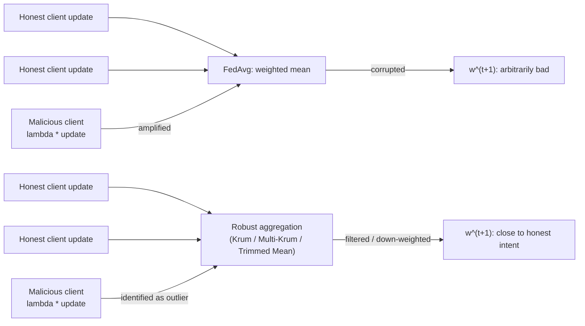
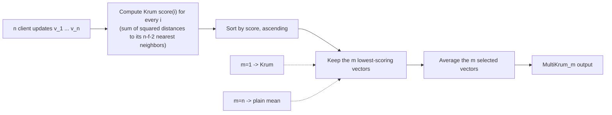
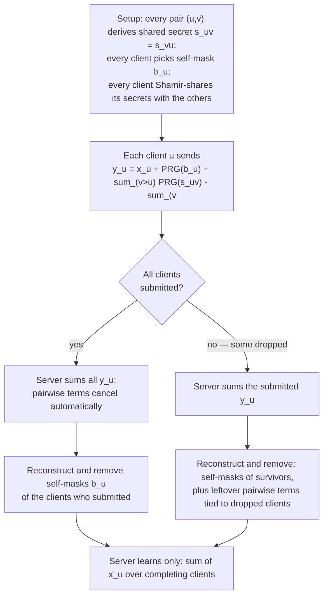
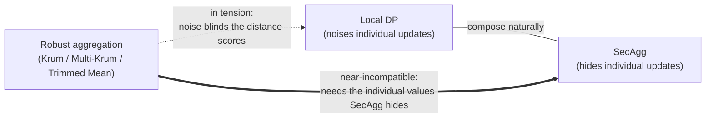

# 31 — Defenses and Privacy in Federated Learning

## Abstract

m30 showed that FedAvg has no Byzantine fault tolerance (a single client scaling its update can collapse the global model) and that an honest-but-curious server can reconstruct private training data from a client's raw gradient. This lesson covers three complementary defenses against those two problems. Byzantine-robust aggregation replaces FedAvg's vulnerable weighted mean with a statistic that tolerates corrupted updates: Krum selects the single most consistent client update, Multi-Krum generalizes Krum to average the $m$ most consistent updates, and Coordinate-wise Trimmed Mean filters extreme values independently per coordinate. Secure Aggregation (SecAgg) is a cryptographic protocol that lets the server learn only the sum of client updates, never any individual one, through a double-masking scheme. Local Differential Privacy (LDP) has each client inject calibrated Gaussian noise into its own update before upload, giving a statistical privacy guarantee that holds even if the server is fully malicious. The lesson closes by reasoning about how these three defenses interact when layered together — and where that layering breaks down.

## Objectives

- State the Krum aggregation rule and the client-count condition $n \geq 2f+3$ under which its Byzantine fault tolerance guarantee holds.
- Generalize Krum to Multi-Krum, implement it, and explain the performance-robustness trade-off controlled by the parameter $m$.
- Explain the Coordinate-wise Trimmed Mean algorithm as an alternative robust aggregation rule.
- Describe the SecAgg double-masking protocol and state exactly what information it hides from the server.
- Apply Local Differential Privacy to client update vectors using the Gaussian mechanism and measure the accuracy cost of a given privacy budget $\epsilon$.
- Reason about the combined effect of layering robust aggregation, SecAgg, and LDP, including where they reinforce each other and where they conflict.

## Content

### From "No Defense" to Byzantine-Robust Aggregation

FedAvg aggregates client updates with a weighted mean, $w^{t+1} = \sum_k \frac{n_k}{n} \Delta w_k^t$. The mean has a **breakdown point of zero**: a single unbounded value among the inputs can shift it arbitrarily far from where it would land if that one input were honest. This is exactly what m30's scaling attack exploited. If one client out of 10 scales its update by $\lambda = 50$ and represents 10% of the data, its effective weight in the average becomes $0.1 \times 50 = 5$, five times an honest client's weight, and the global model drifts toward whatever direction the attacker chose.

A **Byzantine-robust aggregation rule** replaces the mean with a statistic whose breakdown point is strictly positive: it keeps producing a value close to the honest clients' true intent even when up to $f$ of the $n$ inputs are arbitrarily corrupted. The rest of this section covers three such rules, in order of increasing statistical efficiency: Krum (safest, but wastes the most data), Coordinate-wise Trimmed Mean, and Multi-Krum (which contains Krum as a special case and lets you tune the safety/efficiency trade-off directly).

### Krum: Distance-Based Selection

Krum (Blanchard et al., 2017) scores each client's update by how consistent it looks with its neighbors, then keeps only the single best-scoring update. Given $n$ update vectors $v_1, \ldots, v_n$ and an assumed bound $f$ on the number of Byzantine clients, define for each $i$:

$$\mathrm{score}(i) = \sum_{j \in \mathcal{N}_i} \lVert v_i - v_j \rVert^2, \qquad \mathcal{N}_i = \text{the } (n-f-2) \text{ closest of the other } n-1 \text{ vectors to } v_i.$$

Krum's output is the single vector with the smallest score: $\mathrm{Krum}(v_1, \ldots, v_n) = v_{i^\*}$, $i^\* = \arg\min_i \mathrm{score}(i)$. Intuitively, an honest vector sits inside a tight cluster of $n-f$ other honest vectors, so its $n-f-2$ nearest neighbors are mostly honest too, and its score stays small. A Byzantine vector that tries to pull the average away from the honest cluster sits far from that cluster, so its nearest neighbors (if any are honest) are far away too, and its score is large — unless the attacker also controls enough *other* vectors nearby to fake a tight cluster, which is exactly what the client-count condition below rules out.

**Byzantine fault tolerance guarantee.** Krum is $(\alpha, f)$-Byzantine resilient whenever $n \geq 2f + 3$: with at most $f$ Byzantine clients among $n$ total, Krum's output stays within a bounded distance of the true (honest-only) average, a bound that shrinks as the honest updates' own variance shrinks. The $2f+3$ threshold is not a minor technicality — with fewer total clients, $f$ Byzantine participants could coordinate to occupy each other's nearest-neighbor slots, manufacturing an artificially low score for one of themselves, and Krum's guarantee would no longer hold. For $n = 10$, the condition allows $f$ up to $\lfloor (10-3)/2 \rfloor = 3$ Byzantine clients.

**Cost.** Krum discards $n-1$ of the $n$ updates every round, keeping only one. Even when every client is honest, that one update carries all of its own sampling noise with none of the variance reduction that averaging would normally provide. Krum is maximally safe and minimally efficient — the opposite end of the spectrum from the plain mean, which is maximally efficient and has zero safety.

### Coordinate-wise Trimmed Mean

Trimmed Mean (Yin et al., 2018) works coordinate by coordinate instead of vector by vector. For coordinate $j$ and trim parameter $\beta < n/2$:

$$\mathrm{TrimmedMean}_j(v_1, \ldots, v_n) = \frac{1}{n - 2\beta} \sum_{i \,\in\, \mathrm{middle}(n-2\beta)} v_{i,j},$$

where $\mathrm{middle}(n-2\beta)$ is the set of indices remaining after sorting the $n$ clients' values on coordinate $j$ and discarding the $\beta$ largest and $\beta$ smallest. Setting $\beta \geq f$ guarantees that on every single coordinate, any value a Byzantine client pushes to an extreme gets trimmed away, regardless of how the $f$ Byzantine clients coordinate across coordinates.

Trimmed Mean never needs a pairwise distance matrix (just a sort per coordinate, $O(n \log n)$ each, versus Krum's $O(n^2)$ pairwise distances), and it retains $n - 2\beta$ values per coordinate rather than Krum's single vector — closer to Multi-Krum's statistical efficiency than to Krum's. The trade-off is that it mixes and matches coordinates from *different* clients (coordinate 1 of the result might come from client A's filtering, coordinate 2 from client B's), so the output is not any single client's actual update the way Krum's is — a property that is fine for aggregation but means Trimmed Mean cannot double as a "pick one trustworthy client" selection rule the way Krum can.

### Multi-Krum: Generalizing Krum

Multi-Krum computes the *same* Krum scores for all $n$ vectors, then averages the $m$ vectors with the smallest scores instead of keeping only one:

$$\mathrm{MultiKrum}_m(v_1, \ldots, v_n) = \frac{1}{m} \sum_{i \,\in\, S} v_i, \qquad S = \text{the } m \text{ indices with the smallest } \mathrm{score}(i).$$

The parameter $m$ (with $1 \leq m \leq n$) unifies three rules into one formula:

- $m = 1$: Multi-Krum **is** Krum exactly — select only the single best-scoring vector.
- $m = n - f$: keep every vector *except* the $f$ worst-scoring ones — the standard safe choice, since under the $n \geq 2f+3$ guarantee the $f$ Byzantine vectors should score among the worst.
- $m = n$: no filtering at all — Multi-Krum **is** the plain FedAvg mean.

**The performance-robustness trade-off.** Small $m$ means fewer vectors are averaged, so Byzantine vectors have less room to sneak into the selected set and each selected vector (if Byzantine) carries less weight in the average — but the result also reflects less of the honest clients' actual data, so its variance under purely honest conditions stays high (the same cost Krum pays at the $m=1$ extreme). Large $m$ averages more honest signal, reducing variance roughly as $1/\sqrt{m}$ under no attack — but once $m$ exceeds $n - f$, the selection is *forced* to include at least one Byzantine vector no matter how well the scoring worked, reopening the door to the exact vulnerability robust aggregation was meant to close. The lab charts both sides of this trade-off directly: variance under an honest-only run as $m$ increases, and the attack's residual effect once $m$ is pushed past $n - f$.

### Secure Aggregation (SecAgg): Hiding Individual Updates from the Server

Byzantine-robust aggregation defends against a malicious *client*. It does nothing against a malicious or merely curious *server* — and m30's DLG and R-GAP attacks were run by exactly that kind of server, reconstructing a client's private training images directly from that client's own uploaded gradient. Robust aggregation does not help here; Krum, in fact, makes the problem worse in one respect, since its output is literally one client's raw, un-aggregated update, the single most inversion-friendly input DLG could ask for.

Secure Aggregation (SecAgg; Bonawitz et al., 2017) is a cryptographic protocol, not a statistical one. It guarantees that the server learns only the **sum** (or weighted average) of the updates from clients who completed the round — never any individual client's update, and never even which update belongs to which client.

**Double masking.** Each client $u$ adds two kinds of random mask to its true update $x_u$ before sending it:

1. **Pairwise mask.** Every pair of clients $(u, v)$ agrees, via a Diffie-Hellman key exchange, on a shared secret $s_{u,v} = s_{v,u}$ that only those two clients know. Client $u$ adds $+\mathrm{PRG}(s_{u,v})$ for every partner $v$ with $v > u$ and subtracts $\mathrm{PRG}(s_{u,v})$ for every partner $v$ with $v < u$ (any fixed ordering works, as long as every pair uses it consistently). When the server sums the masked values of *all* clients who completed the round, every pairwise term cancels exactly — $u$'s $+\mathrm{PRG}(s_{u,v})$ meets $v$'s $-\mathrm{PRG}(s_{u,v})$ — with no decryption needed at all.
2. **Self mask.** Each client also adds its own individual random mask $b_u$. Self-masks do *not* cancel on their own; they exist to handle **dropout**. Earlier in the protocol, every client used Shamir's $(t, n)$ secret sharing to distribute shares of its own secrets to the other clients. If the round completes with every client online, the server collects enough of those shares from the *surviving* clients to reconstruct and subtract $b_u$ for each client $u$ that did submit. If a client drops out *after* sharing its secrets but *before* submitting its masked update, its partners' leftover, now-unmatched pairwise terms are removed the same way: the surviving clients reveal their shares of the dropped client's secrets, letting the server reconstruct and cancel exactly the terms that lost their partner — nothing more.

$$y_u = x_u + \mathrm{PRG}(b_u) + \sum_{v > u} \mathrm{PRG}(s_{u,v}) - \sum_{v < u} \mathrm{PRG}(s_{u,v}) \pmod{R}$$

Because Shamir's scheme guarantees that fewer than $t$ shares reveal *nothing* about a secret, no single client, and no coalition smaller than $t$, can ever reconstruct another client's mask outside of this controlled cancellation process. The server's final view, after summing and removing exactly the necessary reconstructed terms, is $\sum_u x_u$ over the clients who completed the round — the sum, and only the sum.

### Local Differential Privacy (LDP) with the Gaussian Mechanism

SecAgg hides each client's raw update from the server. It does not limit how much any one client's data could have influenced the *released global model itself* — an attacker who can query or inspect the trained model may still run membership-inference or model-inversion attacks against it, with no raw update ever needing to leak. That requires a statistical guarantee, not a cryptographic one: **differential privacy**.

A randomized mechanism $\mathcal{M}$ is $(\epsilon, \delta)$-differentially private if, for any two inputs differing in one client's full contribution, and any measurable output set $S$: $\Pr[\mathcal{M}(D) \in S] \leq e^{\epsilon} \Pr[\mathcal{M}(D') \in S] + \delta$. Smaller $\epsilon$ means the two possible worlds (this client participated vs. did not) look more alike to an observer — stronger privacy, and typically more noise.

**Local** DP means the noise is added by the *client*, before the update ever leaves the device, rather than by the server after aggregating (central DP). LDP needs no trust in the server or the channel at all — even a fully malicious server never sees a clean update — but it pays for that by needing $n$ independent doses of noise (one per client) instead of central DP's single, smaller dose added once to the already-averaged sum.

**Clipping, then noise.** Each client first clips its update's L2 norm to a fixed bound $C$: $x \leftarrow x \cdot \min(1, C / \lVert x \rVert)$. This bounds the sensitivity of the clipped update to $C$. The client then adds Gaussian noise calibrated by the classical Gaussian mechanism (Dwork and Roth, valid for $\epsilon \in (0, 1)$):

$$\sigma = \frac{C \sqrt{2 \ln(1.25 / \delta)}}{\epsilon}, \qquad x_{\mathrm{noisy}} = x_{\mathrm{clipped}} + \mathcal{N}(0, \sigma^2 I).$$

Smaller $\epsilon$ (stronger privacy) means larger $\sigma$ (more noise added by every client). After the server averages $n$ independently noised updates, the noise on the *aggregate* shrinks (variance of the mean of $n$ independent $\mathcal{N}(0, \sigma^2)$ terms is $\sigma^2/n$), but it never vanishes the way it would if there had been no noise at all — the residual gap between a noised run and a noise-free run, for a fixed number of rounds, is exactly the accuracy cost of the privacy budget $\epsilon$ that the lab measures.

**A note on composition.** This bound covers a single query — one client, one round. Training for many rounds composes privacy loss across rounds; naively multiplying $\epsilon$ by the number of rounds is correct but wasteful. Production DP training (DP-SGD; Abadi et al., 2016) instead uses a *moments accountant* to track composed privacy loss far more tightly across thousands of steps. That accounting is beyond this lesson's scope, but it is the method actually used whenever LDP-style noise is applied across many FL rounds rather than a single one.

### Combining Defenses: Robust Aggregation, SecAgg, and LDP Together

A real deployment rarely uses only one of these three defenses. Layering them is not simply additive — some pairs compose cleanly, and one pair is in direct tension.

**LDP + SecAgg compose naturally.** SecAgg hides *who said what*; LDP bounds *how much any one voice could have swayed the released model's distribution*. Neither needs the other to work, and both narrow a different attack surface: SecAgg blocks a curious server from running DLG/R-GAP on an individual client's raw gradient (m30), while LDP blocks inference attacks against the trained model itself, which no amount of hiding individual updates in transit can prevent. Production systems (e.g., Google's SecAgg + DP deployments) routinely run both together.

**Robust aggregation and LDP are in tension.** Krum, Multi-Krum, and Trimmed Mean all work by assuming honest updates cluster tightly, so a genuine outlier stands out. LDP deliberately injects noise into *every* honest update before the server ever sees it, inflating the apparent spread of the honest cluster. This makes a Krum-style distance score worse at telling a truly malicious outlier apart from an honest client that simply drew a large noise term — weakening the effective robustness of the aggregation rule, and risking that it discards honest-but-noisy updates on top of whatever efficiency it already sacrifices to robustness. Tuning how much LDP noise an FL system can afford without blinding its robust aggregation is an open, active trade-off, not a solved problem.

**Robust aggregation and SecAgg are the sharpest tension, bordering on incompatible in their basic forms.** Krum's score needs every pairwise distance between individual updates; Trimmed Mean needs to sort individual values on each coordinate. Both require the aggregator to see each client's update. SecAgg's entire purpose is to guarantee the server *never* sees any individual update — only the sum. A server running plain SecAgg has no vectors to score or sort; the inputs its aggregation function needs simply are not available to it. Combining the two requires specialized secure multi-party computation that evaluates a Krum-like filter *without* revealing the individual inputs — an active research area, and substantially more expensive than either primitive alone, since now the distance computations or sorting have to happen inside a cryptographic protocol rather than in the clear.

**Practical guidance.** Cross-silo deployments (m29's hospital consortium) have a small number of accountable, contractually bound participants, so Byzantine behavior is less likely; such systems often skip heavy robust aggregation and layer SecAgg with LDP for privacy instead. Cross-device deployments (m29's keyboard app, millions of untrusted personal devices) are far more exposed to m30-style attacks, so they may prioritize robust aggregation and accept that strong SecAgg becomes harder to combine with it — or fall back to a lighter per-update norm-clipping step before an ordinary weighted mean, which is compatible with SecAgg's blindness to individual values at the cost of weaker robustness than true Krum-style filtering.

## Lab

See [lab.ipynb](./lab.ipynb). The lab extends the m29 Flower/TensorFlow FedAvg simulation with a custom aggregation strategy that implements Multi-Krum (with Krum recovered as its $m=1$ special case) and Coordinate-wise Trimmed Mean, and runs real federated rounds against the m30 gradient-scaling attack on MNIST. It works through a numeric double-masking demonstration of SecAgg's mask cancellation, implements Local Differential Privacy as a Flower client that clips and noises its own update, and sweeps Multi-Krum's $m$ parameter and the privacy budget $\epsilon$ across real training runs to chart both the performance-robustness and the $\epsilon$-vs-accuracy trade-offs directly.

## Summary

FedAvg's weighted mean has no Byzantine fault tolerance; Krum and its generalization Multi-Krum fix this by scoring client updates on mutual consistency and keeping only the most consistent $m$, with $m=1$ recovering Krum and $m=n$ recovering the vulnerable plain mean — the parameter that sets where a system sits on the safety/efficiency trade-off. Coordinate-wise Trimmed Mean offers a cheaper, per-coordinate alternative with similar guarantees. Neither defends against a curious server inspecting individual updates; Secure Aggregation closes that gap cryptographically, through a double-masking protocol that lets the server learn only a sum, never an individual contribution, even when clients drop out mid-round. Local Differential Privacy closes a different gap — what the *released model* itself reveals — by having each client add Gaussian noise calibrated to a privacy budget $\epsilon$ before upload, at a measurable accuracy cost. These defenses compose well in some combinations (SecAgg with LDP) and poorly in others (robust aggregation needs exactly the visibility into individual updates that SecAgg is built to deny), and a real system's choice of which to layer depends on its threat model and trust assumptions.

## Useful References and Resources

- Blanchard, P., El Mhamdi, E. M., Guerraoui, R., Stainer, J. "Machine Learning with Adversaries: Byzantine Tolerant Gradient Descent", NeurIPS 2017. Introduces Krum and Multi-Krum and proves the $(\alpha, f)$-Byzantine resilience guarantee under $n \geq 2f+3$.
- Yin, D., Chen, Y., Ramchandran, K., Bartlett, P. "Byzantine-Robust Distributed Learning: Towards Optimal Statistical Rates", ICML 2018. Introduces and analyzes Coordinate-wise Trimmed Mean (and coordinate-wise median) as Byzantine-robust aggregation rules.
- Bonawitz, K., Ivanov, V., Kreuter, B., et al. "Practical Secure Aggregation for Privacy-Preserving Machine Learning", ACM CCS 2017. Defines the SecAgg double-masking protocol used in this lesson.
- Dwork, C., Roth, A. "The Algorithmic Foundations of Differential Privacy", Foundations and Trends in Theoretical Computer Science, 2014. Source of the Gaussian mechanism noise calibration used in this lesson.
- McMahan, H. B., Ramage, D., Talwar, K., Zhang, L. "Learning Differentially Private Recurrent Language Models", ICLR 2018. Applies per-client clipping and Gaussian noise (the DP-FedAvg recipe this lesson's LDP section is based on) in a real federated system.
- Abadi, M., Chu, A., Goodfellow, I., et al. "Deep Learning with Differential Privacy", ACM CCS 2016. Introduces the moments accountant for tight multi-round privacy composition (DP-SGD), referenced as the production approach to composing privacy loss across FL rounds.
- Kairouz, P., McMahan, H. B., Avent, B., et al. "Advances and Open Problems in Federated Learning", Foundations and Trends in Machine Learning, 2021. Surveys the interaction between robust aggregation, secure aggregation, and differential privacy in federated systems.
