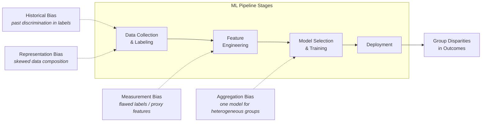
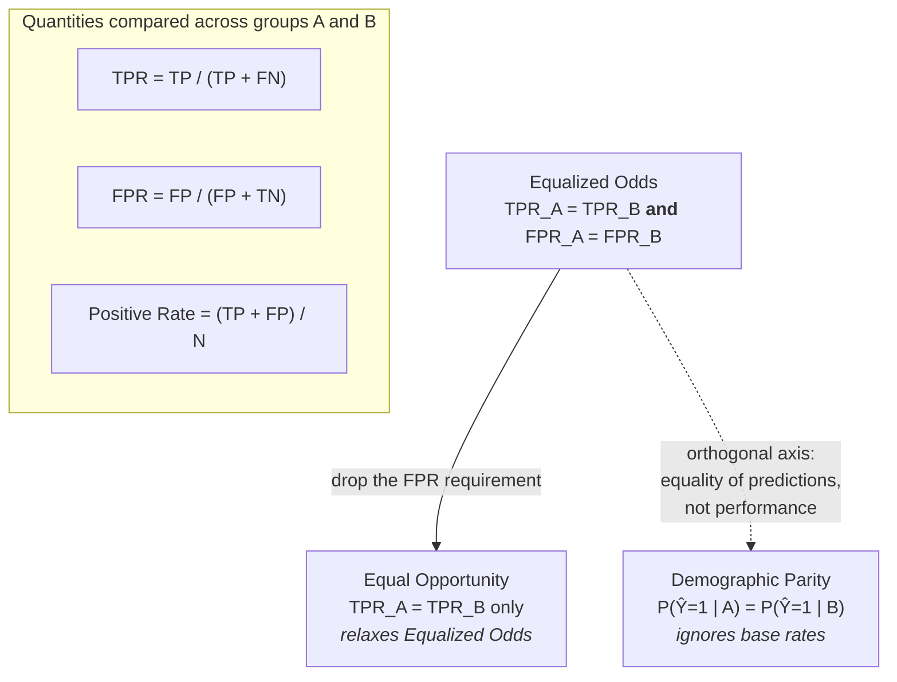
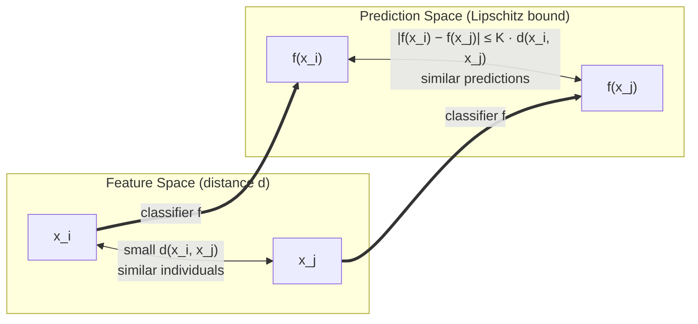
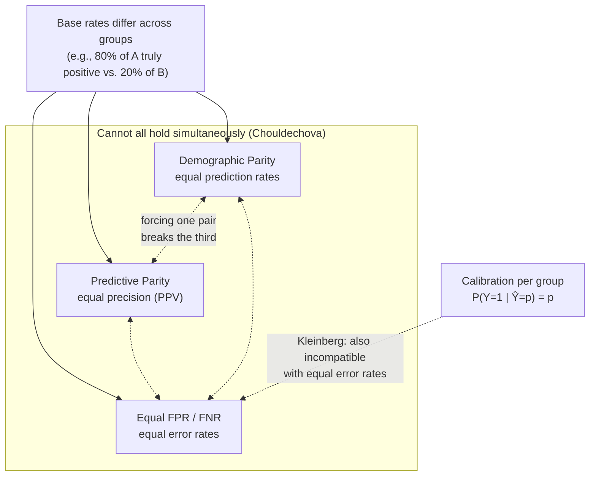
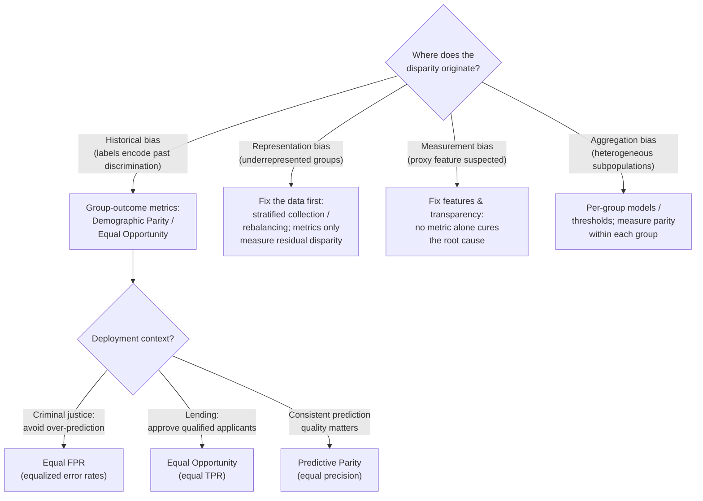

# 32 — Fairness & Bias in AI

## Abstract

Machine learning models deployed in high-stakes domains (lending, criminal justice, hiring) make decisions affecting individuals' lives. When these models produce systematically worse outcomes for particular demographic groups, the harms cascade across populations and undermine public trust. This lesson examines how bias enters ML pipelines, how fairness criteria measure disparity, and why no single metric can satisfy all notions of fairness simultaneously.

## Objectives

- Classify a given bias source into its category (historical, representation, measurement, aggregation) and trace it to the specific ML pipeline stage where it enters.
- Compute Demographic Parity difference, Equalized Odds difference, and disparate impact ratio for a classifier using AIF360.
- Define Equal Opportunity and explain how it relaxes Equalized Odds.
- State the individual fairness Lipschitz condition and explain the role of a task-specific similarity metric.
- State the Chouldechova incompatibility theorem, identify the conditions under which it applies, and provide a concrete example where Demographic Parity and Predictive Parity conflict.

## Content

### COMPAS and Lending: Observable Disparities

The COMPAS recidivism scoring system, deployed in US criminal justice, assigned higher recidivism risk scores to Black defendants than white defendants with identical criminal histories. A 2016 ProPublica investigation revealed COMPAS flagged 45 percent of Black defendants as "high risk" compared to 23 percent of white defendants. The system was used to inform bail, sentencing, and parole decisions. Similarly, lending classifiers deny mortgages to qualified applicants of certain ethnicities at higher rates than others. These disparities matter: a 5 percent difference in approval rates across groups translates to thousands of denied applications annually in major lending markets. Both systems raise a central question for ML practitioners: at what point does statistical disparity become unfairness, and how do we measure it?

### Bias Taxonomy

Bias enters ML pipelines at distinct stages, and each category reflects a different failure mode in data or learning design.

**Historical bias** reflects past discrimination embedded in training data. If historical hiring decisions discriminated against women, a model trained on those decisions replicates the pattern. The model is technically accurate in predicting historical outcomes, but perpetuates historical harm.

**Representation bias** occurs when the training dataset does not fairly represent the population the model will serve. A facial recognition system trained on images skewed toward lighter skin tones generalizes poorly to darker skin tones. The underrepresented group is absent from the learning signal.

**Measurement bias** arises from flawed labels or proxy features. A model predicting "customer reliability" may use late-payment history as a label, conflating unreliability with financial hardship and creating a biased signal. Alternatively, a feature like zip code may be a proxy for unprotected race, embedding racial discrimination indirectly.

**Aggregation bias** emerges when a single model is applied to subpopulations with different underlying distributions. One classifier for loan approval may work well for employed borrowers but poorly for self-employed borrowers, whose income patterns differ. Combining them into one model trades off fairness across groups.

Pipeline stage mapping: Historical bias enters at data collection and labeling. Representation bias is a data-composition problem. Measurement bias reflects choices in feature engineering and labeling design. Aggregation bias occurs at model selection when a single architecture or threshold is forced across heterogeneous populations.

### Group Fairness Criteria

Group fairness metrics measure disparity between protected groups. Three criteria are widely used.

**Demographic Parity** requires equal positive-prediction rates across groups: $P(\hat{Y} = 1 \mid A) = P(\hat{Y} = 1 \mid B)$. In lending, this means approval rates are identical across genders. Demographic Parity is intuitive but ignores base rates: if group A has 80 percent qualified applicants and group B has 20 percent qualified applicants, forcing equal approval rates requires one group to reject qualified candidates or approve unqualified ones.

**Equalized Odds** requires equal true positive rates and false positive rates across groups: $\mathrm{TPR}_A = \mathrm{TPR}_B$ and $\mathrm{FPR}_A = \mathrm{FPR}_B$. This respects base rates but is stringent: it demands equal performance on both correct and incorrect decisions. In practice, this is difficult to achieve without extremely large sample sizes per group.

**Equal Opportunity** requires only equal true positive rates across groups: $\mathrm{TPR}_A = \mathrm{TPR}_B$. Equal Opportunity relaxes Equalized Odds by allowing false positive rates to differ. A lender using Equal Opportunity ensures qualified applicants are approved at the same rate across genders, even if false alarm rates differ. This criterion is especially useful in high-stakes settings where false negatives (rejecting qualified applicants) matter more than false positives (approving unqualified ones).

Equal Opportunity is a relaxation of Equalized Odds, while Demographic Parity is an orthogonal axis (equality of predictions rather than of performance):

**Worked example**: A lending classifier trained on 1000 applicants predicts 100 of 200 female applicants as approvable (approval rate $0.50$) and 150 of 800 male applicants as approvable (approval rate $0.19$). The Demographic Parity difference is $0.50 - 0.19 = 0.31$, indicating large disparity. Among truly qualified applicants (base ground truth), 80 of 100 female applicants and 75 of 150 male applicants are correctly identified as approvable ($\mathrm{TPR}_{\text{female}} = 0.80$, $\mathrm{TPR}_{\text{male}} = 0.50$). This gap in true positives violates Equal Opportunity. Equalized Odds further requires equal false positive rates: the predictions above imply 20 false positives for females ($100 - 80$) and 75 for males ($150 - 75$), so the false positive rates are $\frac{20}{100} = 0.20$ and $\frac{75}{650} \approx 0.12$, showing further disparity.

### Individual Fairness

Individual fairness asks: do similar individuals receive similar predictions? The Lipschitz condition formalizes this. A classifier $f$ satisfies the Lipschitz condition if $|f(x_i) - f(x_j)| \leq K \cdot d(x_i, x_j)$ for all pairs of individuals $i$ and $j$, where $d(x_i, x_j)$ is the distance between their feature vectors and $K$ is a constant. The condition ensures the classifier does not change predictions sharply across small feature perturbations. Individual fairness protects both group averages and individual decisions, making it stronger than demographic fairness alone. The challenge is defining $d(x_i, x_j)$, the similarity metric. What features should count as "similar"? In hiring, should candidates with similar GPAs and skills but different university names be treated similarly? The answer depends on domain expertise and task design. Disagreement on similarity metrics makes individual fairness difficult to operationalize.

### Incompatibility Theorems

No fairness criterion can satisfy all reasonable desiderata simultaneously.

**Chouldechova's theorem** establishes Demographic Parity, Predictive Parity ($\mathrm{PPV}_A = \mathrm{PPV}_B$, equal precision across groups), and Equal FPR/FNR cannot hold simultaneously when base rates differ between groups. Proof sketch: assume base rates differ (e.g., 80 percent of group $A$ is truly positive, 20 percent of group $B$ is truly positive). Demographic Parity requires $P(\hat{Y} = 1 \mid A) = P(\hat{Y} = 1 \mid B)$. For both groups, the ratio of true positives to total positives in each group differs under Demographic Parity when base rates diverge. This forces a trade-off between equal prediction rates and equal performance rates. Concretely, in the lending example above, forcing Demographic Parity across genders (equal approval rates) while maintaining Equal FPR (equal false alarm rates) means the true positive rates must differ. Qualified women or men will be approved at different rates.

**Kleinberg et al. calibration impossibility** extends this to calibrated predictions. A model is calibrated if predicted probability equals true probability: $P(Y = 1 \mid \hat{Y} = p) = p$. Impossibility result: a model cannot be simultaneously calibrated within each group and achieve equal error rates ($\mathrm{FPR}_A = \mathrm{FPR}_B$ and $\mathrm{FNR}_A = \mathrm{FNR}_B$) across groups, except in degenerate cases. The tension arises because calibration per group constrains predictions to reflect true conditional likelihoods, while equal error rates constrain performance to match across groups. These pressures conflict when base rates differ.

**Practical implication**: practitioners cannot optimize for all fairness metrics at once. Metric choice must align with the deployment context and stakeholder values.

### Recap: Mapping Bias Taxonomy to Fairness Metrics and Metric Selection

Addressing bias requires mapping its source to an appropriate metric. If the training data reflects historical discrimination (historical bias), the fairness goal is often to protect group outcomes: Demographic Parity or Equal Opportunity may apply. If the issue is underrepresentation (representation bias), stratified data collection or rebalancing during training is primary, but fairness metrics post-hoc measure residual disparity. If measurement bias is suspected (a feature is a proxy for a protected attribute), feature engineering and transparency become critical, and no metric alone cures the root problem.

Metric selection depends on deployment context. In criminal justice, equal false positive rates (avoiding over-prediction of recidivism for minority defendants) aligns with public values of reducing unnecessary incarceration. In lending, Equal Opportunity (equal approval rates for qualified candidates) may be preferred over Demographic Parity to avoid rejecting qualified applicants to meet a statistical target. Some domains value Predictive Parity (equal precision) to ensure prediction quality is consistent.

No universal rule determines the best metric. Stakeholder engagement, transparency about tradeoffs, and domain expertise guide the choice.

## Lab

See [lab.ipynb](./lab.ipynb). The lab computes group fairness metrics (Demographic Parity, Equalized Odds, Disparate Impact) for a lending classifier trained on the Adult Income dataset and traces the observed disparity to a specific bias taxonomy category.

## Summary

Fairness in AI is a concrete technical problem, not an abstract ideal. Bias enters pipelines through predictable mechanisms: historical discrimination, skewed data, flawed measurement, and pooling across heterogeneous populations. Group fairness metrics quantify disparity, but no metric satisfies all desiderata when base rates differ. Individual fairness formalizes similarity-based protection but requires domain-specific judgment to define similarity. Practitioners must choose metrics deliberately, grounded in deployment context and stakeholder values.

## Useful References and Resources

- Chouldechova, A. (2017). "Fair prediction with disparate impact: A study of bias in recidivism prediction instruments." Big data, 5(2), 153–163.
- Kleinberg, J., Mullainathan, S., & Raghavan, M. (2017). "Inherent Trade-Offs in the Fair Determination of Risk Scores." In Proceedings of Innovations in Theoretical Computer Science (ITCS).
- ProPublica (2016). "Machine Bias." Investigative article examining COMPAS recidivism scoring accuracy across demographic groups.
- Buolamwini, J., & Gebru, T. (2018). "Gender Shades: Intersectional Accuracy Disparities in Commercial Gender Classification." In Conference on Fairness, Accountability and Transparency (pp. 77–91). PMLR.
- AIF360 (AI Fairness 360) Python library documentation (IBM). Fairness metrics and algorithms for bias detection and mitigation.
- Barocas, S., Hardt, M., & Narayanan, A. (2019). "Fairness and Machine Learning." fairmlbook.org. Comprehensive textbook covering fairness theory and practice.
