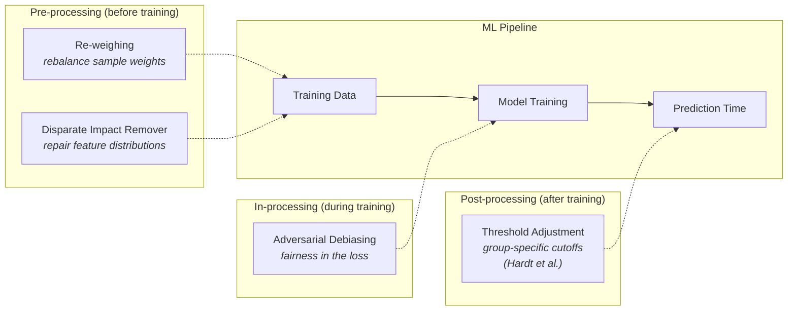
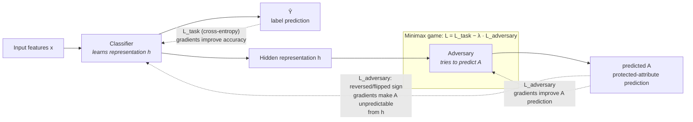
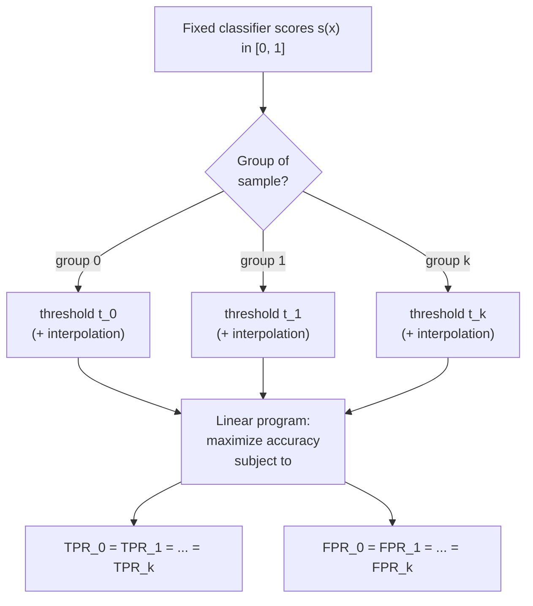
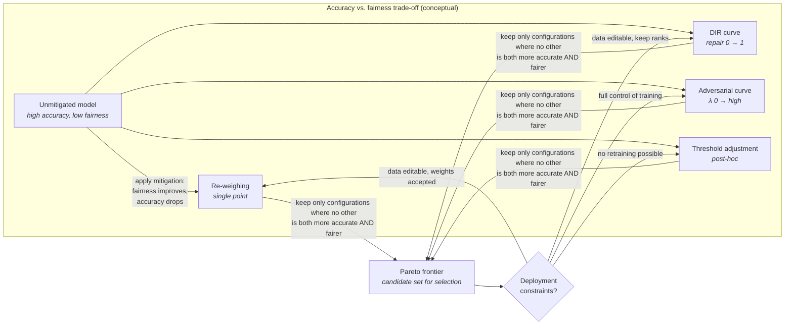

# 33 - Bias Mitigation Strategies

## Abstract

This lesson examines four practical mitigation techniques for reducing bias and improving fairness in deployed classifiers. Mitigation occurs at three distinct points in the ML pipeline: before training (pre-processing), during training (in-processing), and after training (post-processing). Students learn to implement re-weighing, disparate impact remover, adversarial debiasing, and threshold adjustment using the **AIF360** toolkit, and measure the accuracy-fairness trade-off each technique introduces.

## Objectives

- Implement re-weighing using AIF360 and explain how the computed weights correct the skewed joint distribution of protected attribute and label.
- Describe the disparate impact remover transformation and state which correlation suppresses.
- Implement adversarial debiasing using AIF360, explain the two-model training loop, and describe what the adversary's prediction loss signals to the classifier.
- Apply Hardt et al. equalized odds post-processing and verify the resulting classifier satisfies Equalized Odds within a stated tolerance.
- Produce a side-by-side comparison of at least two mitigation approaches showing accuracy cost and fairness improvement across two fairness metrics.

## Content

The four techniques covered in this lesson operate at three distinct points in the ML pipeline:

### Pre-processing Mitigation: Re-weighing

Re-weighing modifies the training data by assigning a weight to each sample. The weight is chosen to make the marginal distribution of the protected attribute independent of the label in the weighted dataset, aligning with the Demographic Parity fairness criterion.

The weight formula for each sample $i$ is:

$w_i = \frac{P(A=a) \cdot P(Y=y)}{P(A=a, Y=y)}$

where $a$ is the protected attribute value and $y$ is the label. This expression computes how much each sample's group needs upweighting or downweighting to achieve parity. A sample from an over-represented group gets a weight less than 1, and a sample from an under-represented group gets a weight greater than 1.

The intuition is rebalancing. The weighted dataset has equal positive-prediction rates across groups when the classifier is trained on samples where favorable-outcome groups are penalized and unfavorable-outcome groups are boosted. No data is removed or created, and the learning algorithm sees replicates of each sample with its assigned weight.

Implementation with AIF360 involves three steps. First, instantiate the Reweighing transformer with the protected attribute name and privileged/unprivileged group identifiers. Second, call fit_transform() on the training dataset to compute and apply the weights. Third, train any standard classifier (logistic regression, random forest, neural network) on the reweighted dataset. The trained model then predicts on the original (unweighted) test data, and fairness metrics are computed against the test set.

Re-weighing assumes the training data is modifiable and the classifier accepts sample weights. When either assumption fails, post-processing or in-processing techniques become necessary. Re-weighing reduces bias proportional to how well the weighting scheme aligns with the underlying group distributions. Misaligned distributions reduce mitigation effectiveness.

### Pre-processing Mitigation: Disparate Impact Remover

Disparate impact remover transforms feature values to remove correlation with the protected attribute while preserving the relative ordering of samples within each group. The transformation applies a repair parameter controlling how aggressively to suppress this correlation.

For each non-protected feature $x_j$, the algorithm:

1. Computes the percentile rank of each sample's $x_j$ value within its own protected-attribute group.
2. Reorders samples by this within-group rank.
3. Assigns each sample the median value at the same quantile of the overall distribution (pooling all groups), optionally blended with the original value according to the repair parameter.

This mapping preserves rank within each group so a sample's relative position among peers in its group does not change. The resulting features have suppressed correlation with the protected attribute.

The repair parameter (0 to 1) controls the transformation strength. At 0, no transformation occurs, and at 1, maximum repair applies. Intermediate values provide a trade-off, allowing the practitioner to balance fairness improvement against preserving predictive signal.

Rank-preserving repair can introduce artificial distributional shifts. The repaired features no longer reflect the original numeric magnitudes, which may degrade model interpretability. Additionally, repair does not guarantee any specific fairness metric. Demographic Parity is not enforced mathematically, only approximated empirically. The transformation removes correlation linearly but does not account for nonlinear confounding paths.

### In-processing Mitigation: Adversarial Debiasing

Adversarial debiasing uses a two-model architecture: a primary classifier and an adversarial predictor. The classifier predicts the target label, and the adversary predicts the protected attribute from the classifier's learned representation (hidden layer outputs). The classifier is trained to minimize prediction error on the label while maximizing prediction error on the protected attribute.

The combined loss function is:

$L = L_{\text{task}} - \lambda \cdot L_{\text{adversary}}$

(minimizing $L$ increases the adversary's loss; equivalently, the classifier minimizes $L_{\text{task}}$ while the adversary minimizes $L_{\text{adversary}}$ in a minimax game), where $L_{\text{task}}$ is the classification loss (cross-entropy for binary targets), $L_{\text{adversary}}$ is the adversary's loss (cross-entropy for protected-attribute prediction), and $\lambda$ controls the weighting. Higher $\lambda$ prioritizes fairness, and lower $\lambda$ prioritizes task accuracy.

During training, gradients flow backward through both losses. The classifier's gradients from $L_{\text{task}}$ point toward improving accuracy on the label. The gradients from $L_{\text{adversary}}$ point toward improving accuracy on the protected attribute from the classifier's representation. To minimize the combined loss, the classifier must learn a representation where the adversary cannot easily predict the protected attribute despite trying.

This creates a minimax game. The adversary adapts its weights to better predict the protected attribute from the current representation. The classifier then adapts to reduce this predictability. Training continues until neither model can improve the combined loss significantly.

Gradient reversal is an implementation detail in some frameworks. Rather than subtracting adversarial gradients, gradient reversal flips the sign of gradients flowing from the adversary into the classifier, forcing the classifier to learn features that confound the adversary. AIF360's `AdversarialDebiasing` implements the adversarial-gradient term directly in its TensorFlow training loop.

Adversarial debiasing requires retraining, so apply when the classifier is under your control. The method works well when the protected attribute has sufficient correlation with the features that the adversary has something to learn from, but may fail when protected-attribute information is completely absent from the input features.

### Post-processing Mitigation: Hardt et al. Equalized Odds Threshold Adjustment

Hardt et al. equalized odds adjustment computes group-specific classification thresholds that maximize overall accuracy while satisfying Equalized Odds: equal true positive rates and equal false positive rates across groups.

The method applies to binary classifiers that output probability scores or soft predictions. Assume the classifier produces a score between 0 and 1 for each sample. Standard thresholding classifies above-threshold samples as positive. Equalized odds adjustment permits different thresholds for each group.

The optimization problem is a linear program. For each group $g$ and each possible threshold $t_g \in [0, 1]$, compute:

- True positive rate: $\mathrm{TPR}_g(t_g) = \frac{\#(\text{predicted positive, label positive, group } g)}{\#(\text{label positive, group } g)}$
- False positive rate: $\mathrm{FPR}_g(t_g) = \frac{\#(\text{predicted positive, label negative, group } g)}{\#(\text{label negative, group } g)}$

Find thresholds $t_0, t_1, \dots, t_k$ that satisfy:

- $\mathrm{TPR}_0 = \mathrm{TPR}_1 = \dots = \mathrm{TPR}_k$ (equal TPRs)
- $\mathrm{FPR}_0 = \mathrm{FPR}_1 = \dots = \mathrm{FPR}_k$ (equal FPRs)
- Maximize overall accuracy

Because thresholds are discrete (tied to the actual score values in the test set), solutions may not satisfy the fairness constraints exactly. AIF360 uses linear interpolation between adjacent threshold values, creating a weighted mixture of two thresholds per group to achieve approximate equality.

Post-processing is the only mitigation option when retraining is not available: the original model is fixed, and thresholds are adjusted at prediction time. Trade-offs are unavoidable. Enforcing equal TPRs and FPRs typically reduces overall accuracy relative to standard thresholding. How much accuracy is lost depends on the data and the group distributions.

### Mitigation-Accuracy Trade-off Curves

Each mitigation technique introduces an accuracy cost to achieve fairness gain. Practitioners must compare trade-offs across techniques to choose an approach aligned with their objectives and constraints.

Plotting accuracy versus fairness metrics reveals the Pareto frontier: the set of configurations that are not dominated. A point is on the frontier if no other configuration is both more accurate and fairer.

A typical workflow plots:

- X-axis: fairness metric value (e.g., absolute Demographic Parity difference, ranging from 0 to 1; the signed difference ranges from −1 to 1).
- Y-axis: accuracy (ranging from 0 to 1).
- One curve per mitigation technique (re-weighing, disparate impact remover, adversarial debiasing, threshold adjustment).

Each curve shows multiple points corresponding to different hyperparameter settings. Re-weighing has no tunable hyperparameter, so typically one point. Disparate impact remover varies the repair parameter from 0 to 1, creating a range. Adversarial debiasing sweeps $\lambda$ from 0 to high values. Threshold adjustment may trade off across group thresholds.

Decision criteria include:

- **No-free-lunch constraint:** fairness interventions typically trade off against accuracy on the original data distribution, unless the data is perfectly balanced across groups.
- **Group size mismatch:** when one group is much smaller, larger accuracy cost is required to achieve fairness.
- **Practitioner tolerance:** acceptable accuracy loss depends on the application. A 5% accuracy drop may be tolerable for lending, unacceptable for medical imaging.
- **Deployment constraints:** post-processing alone may be deployable without retraining. Pre- and in-processing require model retraining.

Comparing all four techniques on the same plot allows ranking by Pareto dominance and selection based on deployment feasibility.

## Lab

See [lab.ipynb](./lab.ipynb). This notebook implements re-weighing and adversarial debiasing on a lending classification task, measures Demographic Parity difference and accuracy before and after each mitigation, and produces a side-by-side comparison table.

## Summary

Bias mitigation occurs at three pipeline stages. Pre-processing modifies data by re-weighing or disparate-impact repair. In-processing adversarial debiasing embeds fairness directly into the training loss. Post-processing threshold adjustment shifts decision boundaries without retraining. Every technique trades off accuracy for fairness. Practitioners select based on deployment constraints, acceptable accuracy loss, and the data's group distribution properties.

## Useful References and Resources

- Calmon, F., Wei, D., Vinzamuri, B., Natesan Ramamurthy, K., & Varshney, K. R. (2017). "Optimized pre-processing for discrimination prevention." Advances in Neural Information Processing Systems (NIPS), 3995–4004. Foundational optimized pre-processing technique description.
- Kamiran, F., & Calders, T. (2012). "Data preprocessing techniques for classification without discrimination." Knowledge and Information Systems, 33(1), 1–33. Original re-weighing method.
- Feldman, M., Friedler, S. A., Moeller, J., Scheidegger, C., & Venkatasubramanian, S. (2015). "Certifying and removing disparate impact." Proceedings of ACM SIGKDD, 259–268. Disparate impact remover (rank-preserving repair).
- Hardt, M., Price, E., & Srebro, N. (2016). "Equality of opportunity in supervised learning." Advances in Neural Information Processing Systems (NIPS), 3315–3323. Threshold adjustment algorithm and equalized odds definition.
- Zhang, B. H., Lemoine, B., & Mitchell, M. (2018). "Mitigating unwanted biases with adversarial learning." AIES '18: Proceedings of the 2018 Conference on AI Ethics and Society, 335–340. Adversarial debiasing method and two-model training loop.
- AIF360 documentation: [https://aif360.readthedocs.io/](https://aif360.readthedocs.io/) Implementation guide for all mitigation techniques in Python.
- AIF360 Jupyter notebooks (GitHub): [https://github.com/Trusted-AI/AIF360](https://github.com/Trusted-AI/AIF360) Runnable examples for each mitigation approach on public datasets.
