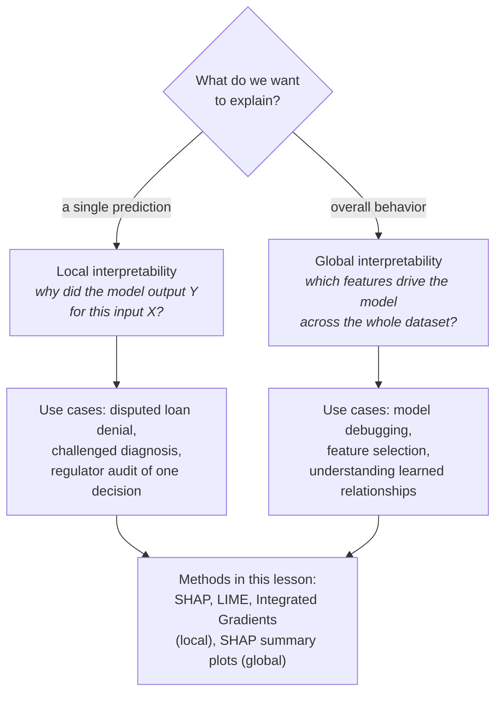
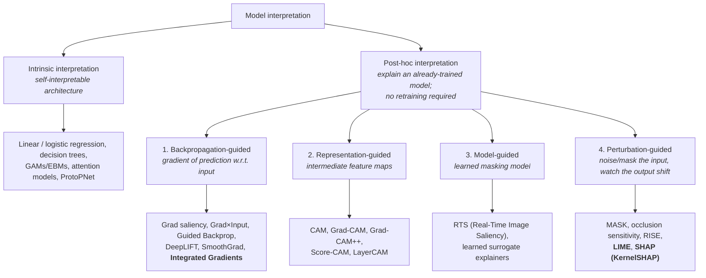
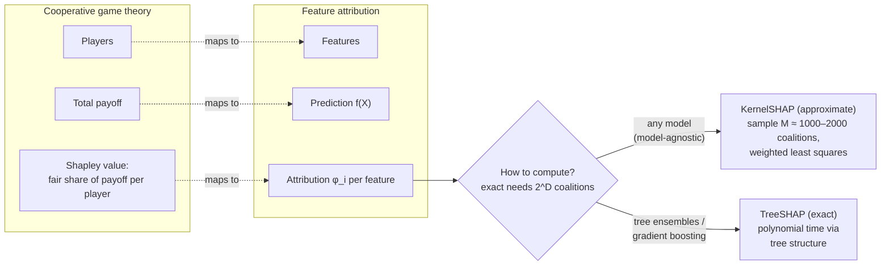
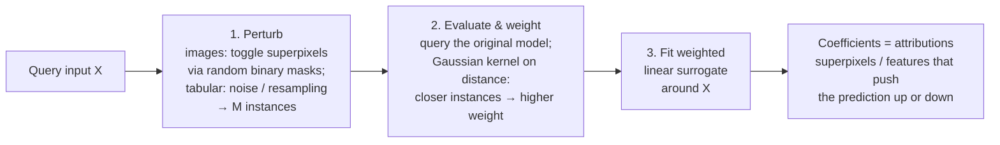
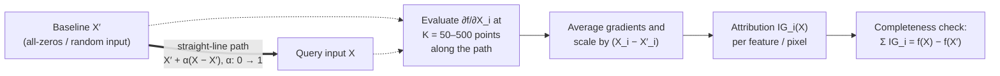
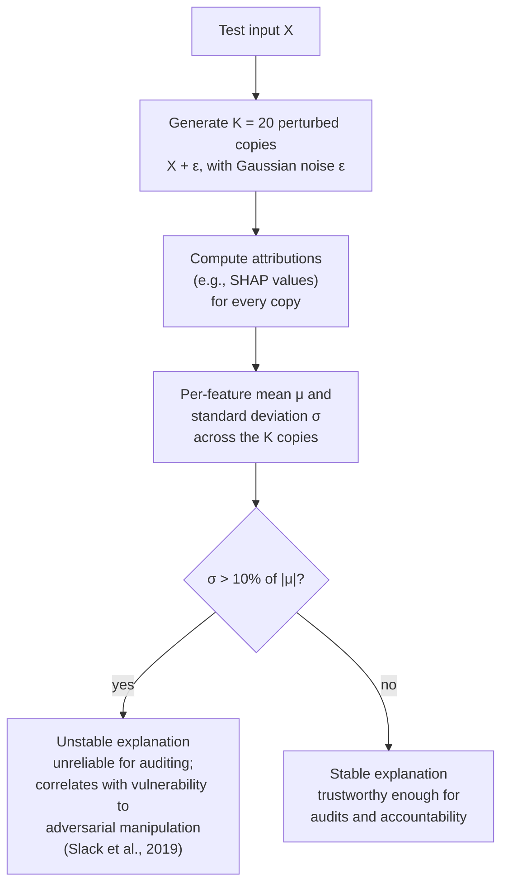

# 34 — Explainable AI and Interpretability

## Abstract

Predictions from complex models matter, but explaining why a model made a prediction is often as important as the prediction itself. This lesson covers techniques for interpreting model behavior at two levels: local explanations answer "why did this model predict X for this input" while global explanations reveal "how does this model behave across all inputs." Students learn Shapley value game theory, LIME's neighborhood sampling approach, and gradient-based Integrated Gradients, then measure explanation stability under perturbations to expose whether explanations are trustworthy for auditing and accountability.

## Objectives

- Student can distinguish local from global interpretability and state a concrete use case for each.
- Student can explain the Shapley value derivation as a fair contribution allocation across players and map it to feature attribution.
- Student can generate SHAP waterfall and summary plots for a tabular model using `shap.KernelExplainer` and interpret the top three positive and negative attributions.
- Student can generate LIME superpixel explanations for an image classifier and identify the five most influential superpixels for a given prediction.
- Student can implement Integrated Gradients for a deep network, verify that attributions satisfy the completeness axiom, and compare attributions to KernelSHAP on the same input.
- Student can measure explanation stability as the standard deviation of SHAP values across 20 perturbed copies of a single input and report whether stability is above or below a defined threshold.

## Content

### Local vs. Global Interpretability

Interpretability splits into two complementary scopes. Local interpretability explains a single prediction: given input X and output Y, which input features drove the model to output Y instead of an alternative? Local questions matter when a customer disputes a loan denial, a patient challenges a medical diagnosis, or a regulator audits a consequential decision. Global interpretability reveals overall model behavior: how does the model rank features by influence across the entire dataset? Global questions inform model debugging, feature selection, and understanding which relationships the model learned. A credit-scoring model might locally explain a specific loan denial (high debt-to-income ratio pushed score below threshold), while global analysis reveals the model relies primarily on payment history and credit utilization across 10,000 applications. Both explain the model, but to different stakeholders at different points in the decision lifecycle.



### A Taxonomy of Interpretation Methods

Model interpretation can be obtained through two basic methods.

**Post-hoc interpretation** explains an already-trained model without modifying it. This can be accomplished by adjusting the complexity of DNNs or by employing post-training techniques. Some strategies even require the development of a new model (a surrogate or masking model) whose sole job is to provide interpretations of the present model. Post-hoc methods are attractive in practice because they apply to any deployed model without retraining.

**Intrinsic interpretation** is produced by developing self-interpretable models, which intrinsically embed the interpretability feature into their structures. Linear and logistic regression, decision trees, generalized additive models (GAMs/EBMs), attention-based architectures, and prototype networks (e.g., ProtoPNet) are intrinsically interpretable: their parameters or architecture *are* the explanation. The trade-off is that self-interpretable models may sacrifice predictive accuracy relative to opaque, high-capacity models.

#### The Four Categories of Post-hoc Interpreters

**1. Backpropagation-guided interpretation.** Interpreters in this category compute the gradient of a DNN's prediction with respect to the provided sample input. This highlights the significance of each feature in the input sample: larger (absolute) gradient values suggest higher importance of the feature to the model's prediction. The canonical example is gradient saliency (vanilla Grad, Simonyan et al., 2014). Other examples include Integrated Gradients (covered below), Grad $\times$ Input, Guided Backpropagation, DeepLIFT, and SmoothGrad (which averages gradients over many noisy copies of the input to sharpen the saliency map).

**2. Representation-guided interpretation.** Interpreters in this category extract feature maps from intermediate layers of the DNN to produce attribution maps, exploiting the spatial and semantic structure learned inside the network rather than relying on input gradients alone. Examples include Class Activation Mapping (CAM), Grad-CAM, Grad-CAM++, Score-CAM, and LayerCAM.

**3. Model-guided interpretation.** Interpreters in this category train a masking model to directly predict the attribution map in a single forward pass, by learning to mask the salient positions of any input. Because the masking model is trained once and then applied at inference time, explanations are produced in real time. The representative example is Real-Time Image Saliency (RTS, Dabkowski & Gal, 2017); learned surrogate explainer models more generally also fall in this category.

**4. Perturbation-guided interpretation.** Interpreters in this category find attribution maps by adding (minimal) noise or masks to the input and examining the resulting shift in the model's output. Features whose removal or corruption shifts the output the most are the most important. Examples include MASK (meaningful perturbations, Fong & Vedaldi, 2017), occlusion sensitivity, RISE (randomized input sampling), LIME, and SHAP.

#### Interpreters, we consider in this lesson: SHAP, LIME, and Integrated Gradients Fit

- **Integrated Gradients** is *backpropagation-guided*: it integrates input gradients along a straight baseline-to-input path, inheriting the gradient-saliency lineage while adding the sensitivity and completeness axioms.
- **LIME** is *perturbation-guided*: it perturbs the input (superpixel toggling for images, noise for tabular data), observes the output shift on each perturbation, and fits a weighted local linear surrogate to summarize which perturbations mattered.
- **SHAP (KernelSHAP)** is *perturbation-guided*: coalitions are masked versions of the input, and Shapley values average the output shift caused by adding each feature. TreeSHAP is the exception that also exploits the model's internal representation (the tree structure) to compute the same values exactly and quickly.



The remainder of this lesson develops the three highlighted methods: SHAP and LIME (perturbation-guided and model-agnostic) and Integrated Gradients (backpropagation-guided, requiring gradient access to the model).

### SHAP (SHapley Additive exPlanations)

SHAP grounds feature attribution in Shapley values from cooperative game theory. In a coalition game, players contribute to a total payoff, and the Shapley value assigns each player a fair share based on their marginal contribution across all possible coalitions. For machine learning, features are players, the model is the game, and the prediction is the payoff. The Shapley value for feature $i$ is the average marginal contribution of feature $i$ when added to every possible subset of the other features.

Formally, for feature $i$ in the feature set $N$ (with $|N| = D$), the Shapley value is the weighted average marginal contribution over all subsets $S$ of the remaining features:

```math
\varphi_i = \sum_{S \subseteq N \setminus \{i\}} \frac{|S|!\,(D - |S| - 1)!}{D!} \left[ f(S \cup \{i\}) - f(S) \right],
```

or equivalently $`\varphi_i = \mathbb{E}\left[f(S \cup \{i\}) - f(S)\right]`$, where $S$ is the (random) set of features that precede $i$ in a uniformly random ordering of all features. This formulation satisfies two axioms. The **local accuracy** axiom states that the sum of feature attributions plus a baseline equals the model output: $`f(X) = \varphi_0 + \sum_{i=1}^{D} \varphi_i`$, where the baseline $`\varphi_0 = \mathbb{E}[f(X)]`$ is the average model output. The **consistency** axiom ensures that if a model changes so that feature $i$'s marginal contribution increases or stays the same for every subset $S$, then feature $i$'s attribution does not decrease.

Computing exact Shapley values on a feature space of $D$ dimensions requires evaluating $2^D$ coalitions, which is infeasible for large $D$. KernelSHAP approximates Shapley values by sampling coalitions. Instead of evaluating all $2^D$ coalitions, KernelSHAP samples $M$ coalitions, evaluates the model on each coalition representation, and solves a weighted least-squares problem to estimate attributions. The Shapley kernel assigns the largest weights to coalitions with very few or very many features present, because those coalitions are the most informative about each feature's individual marginal contribution. For tabular data with dozens of features, KernelSHAP produces accurate approximations with $M \approx 1000$ to $2000$ samples.

TreeSHAP exploits tree structure to compute exact Shapley values in polynomial time for tree ensembles and gradient boosted models. Trees decompose feature interactions into local structure. TreeSHAP walks the tree and computes the exact contribution of each feature along the decision path. For a 1000-tree ensemble, TreeSHAP computes explanations in seconds rather than hours, making explanation audits feasible on production models.



### LIME (Local Interpretable Model-agnostic Explanations)

LIME explains a single prediction by building a local surrogate model around the query input. The intuition is that globally, the model is complex and nonlinear, but locally around a single input, a linear model often approximates the decision boundary well. LIME's algorithm has three steps.

First, LIME perturbs the input in the input space (not the feature space). For images, LIME segments the image into superpixels, then samples random binary masks over superpixels, toggling each superpixel on or off. For tabular data, LIME adds noise to continuous features and uniformly samples categorical features. LIME generates $M$ perturbed instances (typically $M = 1000$ for tabular data, $M = 500$ for images) around the original input.

Second, LIME evaluates the original model on each perturbed instance and records the predictions. LIME also computes the distance from each perturbed instance to the original input: closer instances receive higher weights in a Gaussian kernel.

Third, LIME fits a weighted linear model to the perturbed instances and their predictions, where each instance's weight is the kernel proximity computed in the previous step. The weights emphasize instances similar to the query input, so the linear model captures local decision logic. The coefficients of the linear model are the LIME attributions. For an image, the coefficients tell which superpixels push the prediction up or down. For tabular data, the coefficients rank features by local influence.

LIME's main weakness is sensitivity to the sampling distribution and neighborhood definition. Small changes to the perturbation radius can shift which features appear important. LIME makes no statistical guarantee that the linear surrogate is faithful to the original model in any formal sense.



### Integrated Gradients

Integrated Gradients attributes a prediction to input features by integrating gradients along a straight-line path from a baseline $X'$ (often an all-zeros or random input) to the query input $X$. The method grounds in two axioms. **Sensitivity** states that if the input and the baseline differ only in feature $i$ and the model outputs differ, then feature $i$ must have a nonzero attribution. **Completeness** states that the sum of attributions over all features equals the model output minus the baseline output: $`\sum_i \mathrm{IG}_i(X) = f(X) - f(X')`$.

Integrated Gradients is defined as:

```math
\mathrm{IG}_i(X) = (X_i - X'_i) \int_{0}^{1} \frac{\partial f\big(X' + \alpha\,(X - X')\big)}{\partial X_i} \, d\alpha .
```

The path integral accumulates the gradient of the model output with respect to feature $i$ as we move from the baseline toward $X$. In practice, numerical integration approximates the continuous integral (e.g., a Riemann sum or the trapezoidal rule) by averaging gradients at $K$ discrete points (typically $K = 50$ to $500$) along the path:

```math
\mathrm{IG}_i(X) \approx (X_i - X'_i) \cdot \frac{1}{K} \sum_{k=1}^{K} \frac{\partial f\big(X' + \tfrac{k}{K}\,(X - X')\big)}{\partial X_i} .
```

For a deep convolutional network classifying an image, Integrated Gradients produces a per-pixel attribution map. Pixels with large positive attributions pushed the network toward the predicted class. Pixels with large negative attributions pushed away from it. Integrated Gradients satisfies completeness: summing all pixel attributions reconstructs the output difference between the input image and the baseline. This formal guarantee makes Integrated Gradients useful for auditing, unlike LIME which offers no such guarantee.



### Explanation Stability

Explanations are stable if small perturbations to the input produce small changes to the attributions. A credit-scoring model might assign high attribution to debt-to-income ratio for a borderline applicant. If adding Gaussian noise (standard deviation $\sigma = 0.01$) to the input features changes the attribution to debt-to-income by $50\%$, the explanation is fragile and unreliable for auditing.

Measure stability by generating $K$ perturbed copies of a test input (typically $K = 20$), computing attributions for each perturbed copy, and computing the standard deviation of attributions across the $K$ copies. If the mean SHAP attribution for a feature is $\mu = 0.3$ and the standard deviation across perturbations is $\sigma = 0.15$, the coefficient of variation is $`\mathrm{CV} = \sigma / |\mu| = 0.15 / 0.3 = 0.5`$, indicating substantial instability. Flag features where the standard deviation exceeds $10\%$ of the mean absolute attribution as unstable.

Slack et al. (2019) demonstrated that explanations can be intentionally manipulated. By adding adversarial perturbations to model inputs, an attacker can shift feature attributions to hide discriminatory behavior while maintaining the same predictions. A lending model trained to discriminate by race might learn to weight race heavily in its decision. SHAP values would reveal this discrimination. But with adversarial perturbations in training data, the model learns to hide race's true contribution, and SHAP values report a false attribution. Explanation instability correlates with vulnerability to such attacks.



### Attention to Scope

This lesson focuses on local and global explanations through SHAP, LIME, and Integrated Gradients, and measurement of explanation stability. Fairness metrics and bias mitigation belong to **Lesson 32**. AI governance frameworks and formal auditing processes belong to **Lesson 35**. Guardrail configuration and PII handling belong to **Lesson 39**. Counterfactual explanations (e.g., "if income were $5,000 higher, the prediction would change") and concept-based explanations (TCAV) are outside the course scope.

## Lab

The lab notebook at [lab.ipynb](./lab.ipynb) exercises KernelSHAP on a tabular credit-scoring model, LIME on an image classifier, and measures explanation stability through perturbation analysis. Students generate waterfall and summary plots, identify influential superpixels, and compute per-feature standard deviations to flag unstable attributions.

## Summary

Explaining model predictions requires specifying scope: local explanations answer "why this prediction" while global explanations reveal model-wide tendencies. Shapley values offer a theoretically grounded, consistent foundation for local attribution. KernelSHAP and TreeSHAP make this practical on real models. LIME builds local linear surrogates through neighborhood sampling, offering model-agnostic explanations but without formal guarantees. Integrated Gradients uses gradient paths to produce pixel-level or feature-level attributions satisfying completeness. All three methods are vulnerable to instability: small input changes can shift attributions significantly, raising concerns for use in audits or policy decisions. Measuring stability through perturbation analysis reveals whether explanations are reliable enough for high-stakes applications.

## Useful References and Resources

Taxonomy of interpretation methods (post-hoc vs. intrinsic; the four post-hoc categories):

- Simonyan, K., Vedaldi, A., & Zisserman, A. (2014). Deep Inside Convolutional Networks: Visualising Image Classification Models and Saliency Maps. In ICLR Workshop. [Introduces gradient saliency, the canonical backpropagation-guided method]
- Springenberg, J. T., Dosovitskiy, A., Brox, T., & Riedmiller, M. (2015). Striving for Simplicity: The All Convolutional Net. In ICLR Workshop. [Introduces Guided Backpropagation]
- Shrikumar, A., Greenside, P., & Kundaje, A. (2017). Learning Important Features Through Propagating Activation Differences. In International Conference on Machine Learning (ICML). [Introduces DeepLIFT and the Grad × Input heuristic]
- Smilkov, D., Thorat, N., Kim, B., Viégas, F., & Wattenberg, M. (2017). SmoothGrad: Removing Noise by Adding Noise. In ICML Workshop on Visualization for Deep Learning. [Averages gradients over noisy input copies to sharpen saliency maps]
- Zeiler, M. D., & Fergus, R. (2014). Visualizing and Understanding Convolutional Networks. In European Conference on Computer Vision (ECCV). [Introduces occlusion sensitivity, an early perturbation-guided method]
- Zhou, B., Khosla, A., Lapedriza, A., Oliva, A., & Torralba, A. (2016). Learning Deep Features for Discriminative Localization. In IEEE Conference on Computer Vision and Pattern Recognition (CVPR). [Introduces Class Activation Mapping (CAM), representation-guided]
- Selvaraju, R. R., Cogswell, M., Das, A., Vedantam, R., Parikh, D., & Batra, D. (2017). Grad-CAM: Visual Explanations from Deep Networks via Gradient-based Localization. In International Conference on Computer Vision (ICCV). [Introduces Grad-CAM, representation-guided]
- Chattopadhay, A., Sarkar, A., Howlader, P., & Balasubramanian, V. N. (2018). Grad-CAM++: Generalized Gradient-Based Visual Explanations for Deep Convolutional Networks. In IEEE Winter Conference on Applications of Computer Vision (WACV). [Improves Grad-CAM for multiple object instances]
- Wang, H., Wang, Z., Du, M., Yang, F., Zhang, Z., Ding, S., Mardziel, P., & Hu, X. (2020). Score-CAM: Score-Weighted Visual Explanations for Convolutional Neural Networks. In CVPR Workshops. [Removes gradient dependence from CAM-style maps]
- Jiang, P.-T., Zhang, C.-B., Hou, Q., Cheng, M.-M., & Wei, Y. (2021). LayerCAM: Exploring Hierarchical Class Activation Maps for Localization. In IEEE Transactions on Image Processing. [Uses shallow-layer feature maps for finer localization]
- Dabkowski, P., & Gal, Y. (2017). Real Time Image Saliency for Black Box Classifiers. In Advances in Neural Information Processing Systems (NeurIPS). [Introduces RTS, the canonical model-guided masking interpreter]
- Fong, R. C., & Vedaldi, A. (2017). Interpretable Explanations of Black Boxes by Meaningful Perturbation. In International Conference on Computer Vision (ICCV). [Introduces MASK: minimal input perturbations that shift the output]
- Petsiuk, V., Das, A., & Saenko, K. (2018). RISE: Randomized Input Sampling for Explanation of Black-box Models. In British Machine Vision Conference (BMVC). [Random-masking perturbation-guided attribution]
- Chen, C., Li, O., Tao, D., Barnett, A., Rudin, C., & Su, J. K. (2019). This Looks Like That: Deep Learning for Interpretable Image Recognition. In Advances in Neural Information Processing Systems (NeurIPS). [Introduces ProtoPNet, an intrinsically interpretable architecture]
- Lou, Y., Caruana, R., & Gehrke, J. (2012). Intelligible Models for Classification and Regression. In ACM SIGKDD International Conference on Knowledge Discovery and Data Mining. [Generalized additive models as intrinsically interpretable predictors]
- Nori, H., Jenkins, S., Koch, P., & Caruana, R. (2019). InterpretML: A Unified Framework for Machine Learning Interpretability. arXiv:1909.09223. [Explainable Boosting Machines (EBMs), a modern self-interpretable GAM]

Core methods covered in this lesson:

- Lundberg, S., & Lee, S. I. (2017). A Unified Approach to Interpreting Model Predictions. In Advances in Neural Information Processing Systems (NIPS). [Introduces SHAP and connects Shapley values to feature attribution]
- Ribeiro, M. T., Singh, S., & Guestrin, C. (2016). Why Should I Trust You?: Explaining the Predictions of Any Classifier. In Proceedings of the 22nd ACM SIGKDD International Conference on Knowledge Discovery and Data Mining. [Introduces LIME]
- Sundararajan, M., Taly, A., & Yan, Q. (2017). Axiomatic Attribution for Deep Networks. In International Conference on Machine Learning (ICML). [Introduces Integrated Gradients and completeness axiom]
- Slack, D., Hilgard, S., Jia, E., Singh, S., & Lakkaraju, H. (2019). Fooling LIME and SHAP: Adversarial Attacks on Post-Hoc Explanation Methods. In Proceedings of the 2020 Conference on Fairness, Accountability, and Transparency (FAccT). [Demonstrates adversarial manipulation of explanations]
- `shap` Python package (<https://github.com/slundberg/shap>) [Implements SHAP, KernelSHAP, TreeSHAP with waterfall and summary plot visualization]
- `lime` Python package (<https://github.com/marcotcr/lime>) [Implements LIME for tabular and image data with superpixel segmentation]
- `captum` PyTorch package (<https://captum.ai/>) [Implements Integrated Gradients and other gradient-based attribution methods for neural networks]
