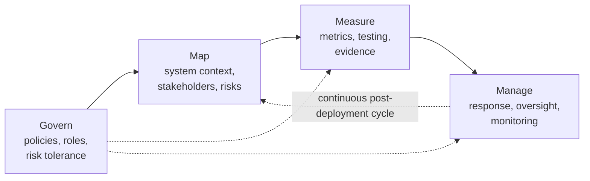
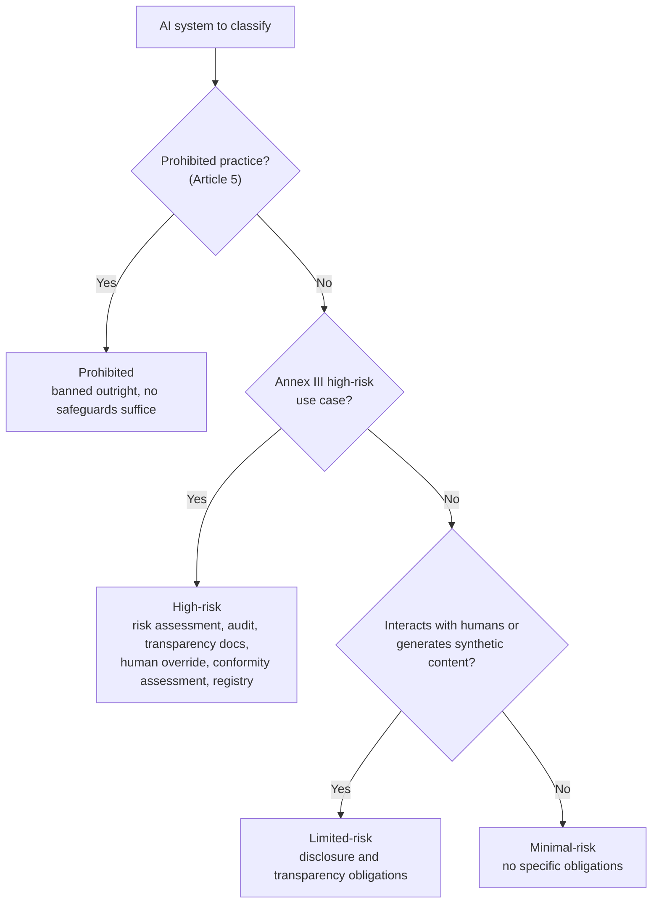
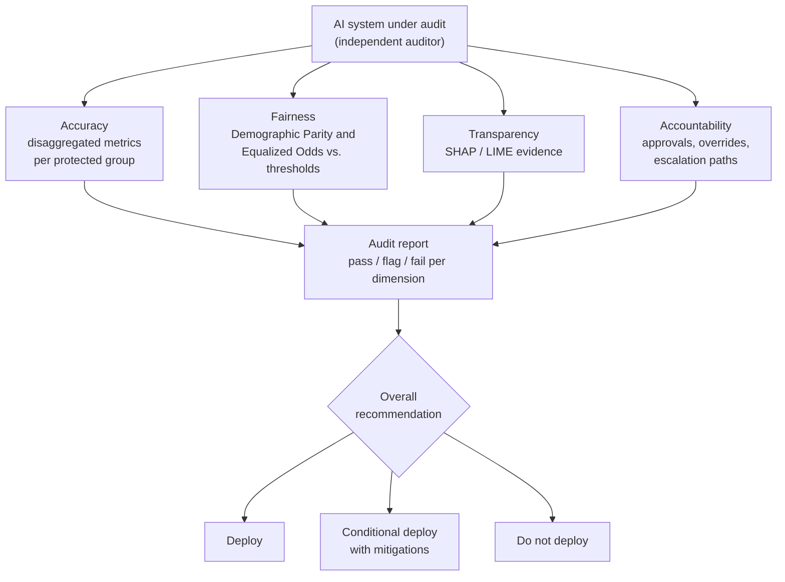
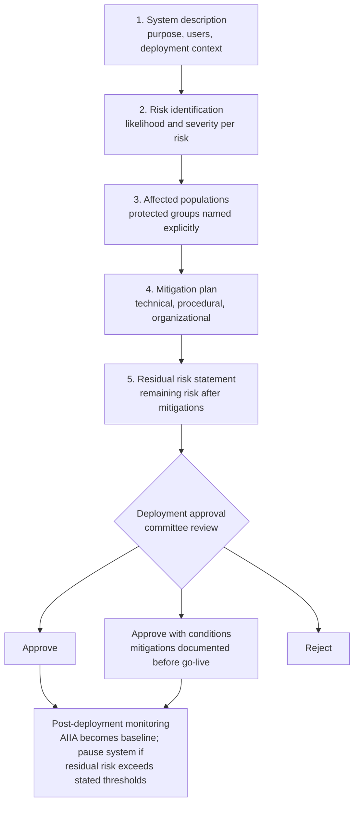
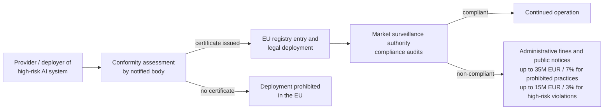

# 35 — AI Governance, Compliance & Risk Frameworks

## Abstract

Technical security and privacy defenses are necessary but insufficient. Organizations deploying AI systems must also establish governance frameworks, conduct algorithmic audits, complete risk assessments, and comply with regulatory requirements. This lesson covers the NIST AI Risk Management Framework, the EU AI Act risk classification system, the structured algorithmic audit process, AI Impact Assessments, and regulatory enforcement mechanisms that shape deployment decisions.

## Objectives

- Student can name the four NIST AI RMF core functions and list at least two subcategory actions under each.
- Student can classify a given AI application under the correct EU AI Act risk tier (prohibited, high-risk, limited-risk, or minimal-risk) and provide written justification referencing the relevant Annex or Article.
- Student can conduct a structured algorithmic audit of a classifier covering at least four dimensions: accuracy, fairness, transparency, and accountability.
- Student can produce a complete AI Impact Assessment document for a high-risk AI deployment scenario, including all five required components: system description, risk identification, affected populations, mitigation plan, and residual risk statement.
- Student can describe at least one regulatory enforcement mechanism under the EU AI Act and state what entity bears liability for a non-compliant high-risk AI system.

## Content

### Why Governance Matters

Technical mitigations alone are insufficient. A classifier trained with adversarial robustness techniques, differential privacy, and fairness constraints still requires human oversight and organizational accountability. Regulatory frameworks exist because AI systems affect human welfare at scale. Biased hiring classifiers cause discriminatory hiring decisions. Faulty credit-scoring models lock vulnerable populations out of loans. Misaligned language models spread disinformation.

In June 2024, the EU formally adopted the AI Act, the first comprehensive AI regulation worldwide. The regulation enforces compliance deadlines starting in 2025, with penalties reaching $35$ million euros or $7\%$ of annual global turnover (whichever is higher) for prohibited practices, and up to $15$ million euros or $3\%$ for violations of high-risk system obligations. Organizations face liability for deploying high-risk AI systems without proper risk management, audits, and impact assessments. This regulatory pressure, combined with reputational risk and liability exposure, drives governance adoption in practice.

Governance frameworks, by contrast, provide structured methods to identify risks before deployment, document evidence of due diligence, and respond to harms after deployment. They serve three purposes: internal (organizational decision-making and risk tracking), external (regulatory compliance and audit readiness), and post-deployment (liability defense when harms occur).

### NIST AI Risk Management Framework

The NIST AI Risk Management Framework (AI RMF) provides a structured approach to identifying, measuring, and managing AI risks across organizations. Released in January 2023, the AI RMF defines four core functions that operate in sequence and then cycle: Govern, Map, Measure, and Manage.

**Govern** establishes organizational context and policy. Govern actions include defining AI governance structures (a risk committee or AI ethics board), documenting organizational risk tolerance and values, establishing roles and responsibilities, and creating policies for human oversight and escalation. A Govern action might read: "The organization designates a Chief AI Officer responsible for approving deployments of any AI system scoring above threshold risk level 3 on the organizational risk scale."

**Map** characterizes the specific AI system, its context, and its risks. Map actions include documenting the system purpose and intended users, defining the data pipeline and model architecture, identifying affected stakeholders and their vulnerabilities, and cataloging known risks from threat taxonomies (for example, NIST AI RMF threat categories from lesson 07: adversarial manipulations, failures in adversarial robustness, prompt injection attacks, data poisoning, model inversion). A Map action might read: "Create a data lineage diagram showing training data sources and collection procedures, and document any known biases in historical data."

**Measure** establishes metrics and testing procedures to quantify AI risks. Measure actions include defining fairness metrics appropriate to the deployment context (demographic parity, Equalized Odds, or group thresholds), setting up accuracy testing disaggregated by protected groups, implementing adversarial robustness testing using FGSM or stronger attacks, and collecting evidence for model transparency via SHAP or LIME. A Measure action might read: "Evaluate the model's accuracy separately for each protected group (sex, race, age) and document any disparity larger than $5$ percentage points."

**Manage** implements response and recovery procedures when risks are detected. Manage actions include defining escalation procedures (when to halt deployment, when to notify leadership), implementing human-in-the-loop oversight, designing remediation workflows (model retraining, reweighting, or retirement), and establishing post-deployment monitoring systems. A Manage action might read: "If the model's false positive rates satisfy $\mathrm{FPR}_A - \mathrm{FPR}_B > 0.10$ ($10$ percentage points), halt deployment until the model is retrained with fairness constraints."

The AI RMF is not a one-time assessment. Risk management cycles continuously. After an AI system is deployed, Measure and Manage functions remain active, collecting ongoing performance data, detecting performance drift, and triggering model updates or system shutdowns if necessary.

### EU AI Act Risk Tier Classification

The EU AI Act establishes four risk tiers and applies different regulatory requirements to each. Risk classification determines the specific governance and audit obligations for a deployment.

**Prohibited AI practices** are banned outright. Examples include social credit systems that publicly rank individuals' behavior, facial recognition in public spaces without narrow exceptions (law enforcement in real-time identification of kidnapping victims), and emotion-recognition systems used to assess worker fatigue or student engagement in schools. Organizations cannot deploy prohibited AI systems anywhere, regardless of safeguards or risk mitigation.

**High-risk AI systems** trigger mandatory compliance obligations. Annex III of the AI Act lists high-risk use cases across eight domains: biometric identification and categorization, critical infrastructure control, education and vocational training, employment, essential private and public services, law enforcement, migration and asylum and border control, and administration of justice and democratic processes. A hiring classifier falls into the "employment" category because it directly affects hiring decisions. A credit-scoring system falls into "essential services" because it determines loan eligibility. High-risk AI systems require risk assessments, algorithmic audits, transparency documentation, human override capabilities, and compliance registries before deployment. The EU maintains a public registry of registered high-risk AI system providers.

**Limited-risk AI systems** have transparency obligations. These are systems that interact with humans and create a reasonable risk of harm through deception. A chatbot that fails to disclose it is AI, or a deepfake that impersonates a public figure, falls into limited-risk. Organizations must label AI-generated content as such, provide transparency notices to users, and maintain basic usage logs. No formal audit or risk assessment is required, but disclosure is mandatory.

**Minimal-risk AI systems** have no specific compliance obligations. A spam filter, a weather forecasting model, or a Pac-Man game trained with a neural network are minimal-risk. Organizations may deploy them without audits, registries, or special documentation.

Classifying an application correctly is the first step in compliance. A classifier that operates on employment data but is only used for internal reporting (not binding hiring decisions) may escape high-risk classification and fall into limited-risk or even minimal-risk. A classifier that feeds into hiring recommendations faces high-risk classification. Consulting documentation and legal guidance is necessary for borderline cases, but the framework provides clear criteria for common scenarios.

### Algorithmic Audit Process

A structured algorithmic audit assesses whether an AI system meets defined fairness, accuracy, transparency, and accountability standards before or after deployment. Audits differ from standard validation. Validation measures model performance on a held-out test set. An audit measures whether the model meets organizational policy requirements and regulatory compliance thresholds.

An audit spans four dimensions.

**Accuracy dimension**: disaggregate model performance by protected group. Compute accuracy, precision, recall, and false positive rate for each group separately. Document disparities. Report: "Overall accuracy $92\%$; for group A accuracy $89\%$, for group B accuracy $94\%$. Disparity: $\lvert 94\% - 89\% \rvert = 5$ percentage points." If no disparity threshold was defined in the Govern phase, flag this for decision-makers.

**Fairness dimension**: compute fairness metrics using standard definitions. The Demographic Parity difference measures the gap in positive prediction rates across groups $a$ and $b$:

$$\Delta_{\mathrm{DP}} = \left| \, P(\hat{Y} = 1 \mid A = a) - P(\hat{Y} = 1 \mid A = b) \, \right|$$

The Equalized Odds difference measures the gap in true positive rates and false positive rates:

$$\Delta_{\mathrm{EO}} = \max\!\left( \left| \mathrm{TPR}_a - \mathrm{TPR}_b \right|, \; \left| \mathrm{FPR}_a - \mathrm{FPR}_b \right| \right)$$

Report values exactly: "$\Delta_{\mathrm{DP}} = 0.08$. Threshold: $0.05$. Status: failed ($0.08 > 0.05$)." Specific numbers enable tracking and consistent decision-making.

**Transparency dimension**: collect evidence of model explainability. Run SHAP or LIME on a sample of predictions. Examine whether feature importance rankings are reasonable and whether explanations are actionable. Report findings: "SHAP analysis shows top $3$ features account for $72\%$ of variance in $89\%$ of test examples. Examination confirms features are aligned with domain expertise." Document whether explanations reveal biases (for example, if SHAP shows 'gender-related proxy variables' rank high, flag this).

**Accountability dimension**: assess organizational safeguards. Document who approved the model deployment, who has authority to halt or update the model, and what human override procedures exist. Verify that affected populations and regulatory bodies can report harms and request model reviews. Report: "Deployment approved by Chief AI Officer. Model update authority granted to Model Governance Committee. User escalation path documented in SOP 2401. External audit by third-party auditor scheduled annually."

An audit requires independence. The entity conducting the audit should not be the same entity that built or deployed the model. Many organizations hire third-party auditors, certification bodies, or notified bodies (in EU AI Act terminology, "notified bodies" are independent conformity assessment organizations accredited by national authorities) to conduct audits. Independence reduces conflicts of interest and increases external credibility.

Audit findings are documented in a structured report. The report names each dimension, lists findings (specific data and examples), assigns a compliance status (pass, flag, fail) per dimension, and concludes with an overall recommendation: "deploy", "conditional deploy (with mitigations)", or "do not deploy". This structure enables consistent decision-making and provides defensible documentation in case of future regulatory inspection or litigation.

### AI Impact Assessment

An AI Impact Assessment (AIIA) is a structured document that analyzes potential harms and mitigation strategies for a high-risk AI deployment. AIIAs are mandatory for high-risk AI systems under the EU AI Act and are commonly required by internal governance policies.

An AIIA consists of five components.

**System description**: one to two paragraphs describing the AI system, its purpose, intended users, and deployment context. Example: "The hiring classifier is a neural network trained on 10 years of past hiring decisions across 500 job listings. The model predicts whether a candidate should advance to interview given resume data, educational background, and interview performance patterns from historical cohorts. The system is deployed by the recruiting team as part of the resume-screening process."

**Risk identification**: list potential harms and assign each a likelihood and severity score. Organize by risk dimension: fairness, accuracy, adversarial robustness, data quality, transparency, accountability. For each risk, report: "Risk: demographic bias in hiring recommendations. Likelihood: high (fairness metrics show an $8\%$ disparity in false positive rates by race). Severity: high (hiring decisions directly affect employment outcomes for protected populations). Residual risk after mitigation: medium."

**Affected populations**: identify whose welfare is at stake. Name protected groups explicitly. Example: "Affected populations: job candidates from racial and ethnic minorities, candidates with non-traditional educational backgrounds, candidates from economically disadvantaged communities. Impact: biased model recommendations disproportionately filter out candidates from these groups, reducing interview opportunities and employment outcomes."

**Mitigation plan**: for each identified risk, describe the mitigation. Example for demographic bias: "Mitigation 1: train model with fairness constraints (Demographic Parity, Equalized Odds); Mitigation 2: manually review top $100$ candidates flagged by model weekly; Mitigation 3: log all rejections and conduct quarterly audit for disparities; Mitigation 4: establish appeals process for candidates rejected by model." Mitigations span technical (adversarial training, reweighting, threshold adjustment), procedural (human review, escalation), and organizational (governance, transparency, accountability).

**Residual risk statement**: after mitigations are deployed, describe remaining risks. Example: "After applying fairness constraints and weekly human review, residual demographic parity disparity is $3\%$, within the organizational threshold of $5\%$ ($0.03 < 0.05$). Residual risk remains moderate because the model still influences recommendation order before human review, and hiring managers' unconscious biases may amplify model predictions. Quarterly audits and appeals reviews are required to track residual risk over time."

Completion of an AIIA drives deployment decisions. A deployment approval committee reviews the AIIA and votes: "approve", "approve with conditions", or "reject". Approvals with conditions typically require the organization to implement and document completion of all mitigations before the system goes live. After deployment, the AIIA becomes a baseline. Subsequent audits measure whether residual risks remain within stated bounds and whether new risks have emerged. If residual risks exceed stated thresholds, the system is paused for retraining or retirement.

### Regulatory Enforcement

The EU AI Act establishes enforcement mechanisms and liability frameworks. These mechanisms translate policy into organizational compliance incentives.

**Market surveillance authorities** (national regulators in each EU member state) conduct compliance audits of deployed AI systems. Authorities can request documentation, demand algorithmic audits, and conduct forensic analysis of model decisions. Non-compliance findings result in administrative fines and public notices, damaging organizational reputation.

**Conformity assessment** is a pre-market approval procedure for high-risk systems. Organizations must submit risk assessments and audit reports to notified bodies, independent third-party certifiers accredited by national authorities. Notified bodies verify compliance and issue certificates. Systems without certificates cannot be legally deployed in the EU.

**Liability and penalties**: providers of high-risk AI systems that cause harm bear primary liability, and deployers carry their own obligations (human oversight, input data quality, usage monitoring). If a hiring classifier illegally discriminates, the organization faces fines of up to $15$ million euros or $3\%$ of annual global turnover (whichever is higher) for violating high-risk obligations; engaging in a prohibited practice raises the ceiling to $35$ million euros or $7\%$. If the harm also violates employment discrimination law, additional civil liability (damages paid to affected individuals) applies. Managers who knowingly authorized non-compliant deployments face personal criminal liability in some member states.

For prohibited practices, liability is strict. Any deployment, regardless of intent or safeguards, is a violation. For high-risk systems, liability is fault-based: organizations that conducted adequate risk assessments, audits, and mitigation are less likely to face liability than organizations that did not. The AIIA becomes critical evidence. In litigation, a thorough AIIA demonstrates due diligence. A missing or superficial AIIA suggests negligence.

The regulatory framework globally is converging. The US Executive Order on AI (2023) requires federal agencies to conduct impact assessments and algorithmic audits for high-risk systems. China's AI regulation focuses on content moderation and national security. Canada and the UK are developing their own AI governance frameworks. Organizations operating internationally must track multiple regulatory regimes simultaneously.

## Lab

This lesson's lab conducts a structured algorithmic audit on a hiring-decision classifier and produces a complete AI Impact Assessment for a high-risk deployment scenario, concluding with a deployment recommendation. See [lab.ipynb](./lab.ipynb).

## Summary

Governance frameworks translate technical safeguards into organizational practice and regulatory compliance. The NIST AI RMF organizes risk management into four continuous functions (Govern, Map, Measure, Manage), while the EU AI Act classifies systems into four risk tiers with mandatory audits for high-risk deployments. Algorithmic audits assess systems across accuracy, fairness, transparency, and accountability; AI Impact Assessments document harms, affected populations, and mitigations, providing evidence for deployment approval. Regulatory enforcement via market surveillance, conformity assessment, and liability creates organizational incentives to implement governance seriously.

## Useful References and Resources

- National Institute of Standards and Technology. "Artificial Intelligence Risk Management Framework (AI RMF 1.0)." January 2023. Foundational document defining Govern, Map, Measure, Manage functions and subcategories.
- European Union. "Regulation (EU) 2024/1689 on Artificial Intelligence" (AI Act). Official Journal of the European Union, July 2024. Annex III lists high-risk AI system categories; Article 5 defines prohibited practices; Article 6 defines high-risk classification; Article 43 defines conformity assessment procedures; Article 99 defines penalties.
- Selbst, A. D. & Barocas, S. (2018). "The Intuitive Appeal of Explainable Machines." Fordham L. Rev. 87, 1085. Discusses limitations of explainability as an accountability mechanism and the need for audits beyond transparency.
- Reuben Binns. "Algorithmic Accountability and Public Reason." Philosophy and Technology, 2018. 31(4), 543-556. Theoretical framework for audits as evidence of due diligence in institutional AI deployments.
- Ada Lovelace Institute and Algorithm Audit. "Algorithmic Audit Handbook." 2023. Practical step-by-step procedures for conducting audits, including templates for findings documentation and remediation tracking.
- Recode. "Inside the AI Audit Industry." Vox Media, July 2023. Profile of leading third-party auditors and notified bodies; illustrates market structure and audit costs.
- Mitchell, M., et al. (2019). "Model Cards for Model Reporting." arXiv:1810.03993. Standard format for documenting model performance disaggregated by group and defining fairness metrics per deployment context.
