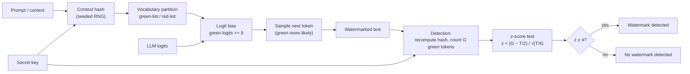

# 38 — Model Watermarking, IP Protection & Machine Unlearning

## Abstract

LLM providers face two overlapping threats: model extraction attacks that steal a model's weights or behavior, and regulatory mandates (GDPR Article 17) to erase training data upon request. This lesson covers LLM output watermarking via token-bias detection, methods for identifying machine-generated text, and machine unlearning approaches that remove a training sample's influence from an already-trained model. Together, these techniques enable organizations to prove model provenance and respect user rights to erasure without retraining from scratch.

## Objectives

- Explain the Kirchenbauer green-list/red-list token-bias watermarking scheme: vocabulary partitioning, biased sampling, and the embedded statistical signal.
- Implement the Kirchenbauer scheme on GPT-2 output, generate 50 watermarked completions, and compute the detection z-score for watermarked text.
- Measure watermark survival rate after paraphrasing attacks and identify which strategies most degrade the watermark signal.
- Describe at least one AI-generated text detection approach (perplexity-based or classifier-based) and state its limitations.
- State the GDPR Article 17 right to erasure, explain why SISA exact unlearning provides stronger guarantees than approximate unlearning, and identify when approximate unlearning is the only practical option.
- Apply gradient ascent approximate unlearning to remove a target training sample's influence and verify that a membership inference attack can no longer classify it as a training member above a defined threshold.

## Content

### LLM Output Watermarking via Green-List/Red-List Token Bias

Watermarking embeds a statistical signal into an LLM's output so the model owner can later prove that text came from their system. The Kirchenbauer et al. scheme works by partitioning the vocabulary into two sets: green-list and red-list tokens.

At generation time, before each token is sampled, the generator computes a context hash from the current prompt and a secret key. This hash seeds a random number generator that marks a fraction of the vocabulary as green-list tokens for this context and the remainder as red-list. The generator then biases the logits (pre-softmax scores) of all green-list tokens upward by a fixed bias $\delta$. This makes green-list tokens statistically more likely to appear in the output than they would under an unbiased model.

A reader without knowledge of the secret key cannot deliberately generate green-list tokens because the list changes with every context. But after an LLM owner generates text, they can recompute the context hash with their secret key, recover the green-list for that context, and check whether the output contains more green-list tokens than random chance would predict.

The key insight is that the statistical signal is subtle. The bias $\delta$ is small enough (typically $0.5$ to $2.0$ on logits) that the output remains fluent and indistinguishable from unbiased generation to a human reader. Yet the bias is large enough that a statistical test can reliably detect it.

### Watermark Detection via Z-Score Hypothesis Test

Watermark detection operates as a statistical hypothesis test. Let $T$ denote the total number of tokens in a text, and $G$ denote the count of green-list tokens in that same text. Under the null hypothesis (no watermark), $G$ is a binomial random variable with parameters $T$ and $p = 1/2$ (assuming equal partition of the vocabulary). The expected value of $G$ is $\mathbb{E}[G] = T/2$ and the standard deviation is $\sqrt{T/4}$.

The z-score is computed as
$$z = \frac{G - T/2}{\sqrt{T/4}}.$$
A z-score above a significance threshold (typically $z \geq 4$) rejects the null hypothesis with high confidence and indicates that the text is watermarked.

For example: if a $200$-token text contains $G = 112$ green-list tokens, then
$$z = \frac{112 - 100}{\sqrt{50}} = \frac{12}{7.07} \approx 1.7.$$
If the same $200$-token text contains $G = 128$ green-list tokens, then
$$z = \frac{128 - 100}{\sqrt{50}} = \frac{28}{7.07} \approx 3.96,$$
just below threshold. At $G = 130$ green-list tokens,
$$z = \frac{130 - 100}{\sqrt{50}} = \frac{30}{7.07} \approx 4.24,$$
which exceeds the threshold and signals detection.

The p-value associated with a z-score of $4.0$ is approximately $3$ in $100{,}000$, so a threshold of $z = 4.0$ means that random text has a $0.003\%$ chance of falsely triggering the detector.

### Watermark Robustness to Paraphrasing

A watermarked text remains detectable only if the paraphrase retains enough green-list tokens from the original. Paraphrasing attacks substitute tokens with synonyms or rearrange sentence structure to degrade the watermark signal.

In practice, the watermark survives some paraphrase attacks better than others. A machine-paraphrase model that replaces high-frequency tokens (common words like "the" or "is") often preserves green-list tokens because many common tokens may be marked green. However, a paraphrase model that replaces rare tokens or uses structural rewrites may eliminate more green-list tokens and reduce the z-score below detection threshold.

Empirical studies of the Kirchenbauer scheme show that 50 to 70 percent of watermarked text remains detectable after passing through a commercial paraphrase API. The survival rate depends on the aggressiveness of the paraphrase model and the original watermark bias strength. Stronger bias (larger $\delta$) results in higher survival, but risks making the output less fluent or more noticeably "artificial."

### Synthetic Content Detection

Beyond watermark detection, organizations deploy AI-generated text detectors to identify text that may come from any LLM, not just their own model. Two common approaches are perplexity-based detection and fine-tuned classifier detection.

Perplexity-based detectors use a small language model (trained only on human-written text) to score each text. The perplexity is the inverse probability of the text under the model. Machine-generated text often has lower perplexity (higher probability) under models trained on human text because LLMs learn the statistical patterns of their training data and produce text that fits those patterns closely. The detector flags text with perplexity below a threshold. A limitation of this approach is that high-quality, well-aligned LLM outputs designed to mimic human style can still have low perplexity scores and evade detection.

Classifier-based detectors are fine-tuned models trained on pairs of human and machine-generated text from a specific LLM or a pool of LLMs. These detectors reach accuracy above 90 percent on in-distribution data. However, they generalize poorly to unseen LLMs or to text that has been slightly paraphrased, adversarially perturbed, or edited by a human. A detector trained on GPT-3 outputs may fail on Llama-2 outputs, and both fail if a student copies GPT-3 output and edits 10 percent of the words.

### Machine Unlearning Motivation: GDPR Article 17 and Retraining Infeasibility

GDPR Article 17 grants individuals the "right to erasure": if a person requests that their data be deleted, an organization must erase it and take reasonable steps to notify third parties who hold copies of the data. For machine learning systems, this creates a legal obligation to remove a user's training data from the model.

The naive approach is to retrain the model from scratch, excluding the target user's data. For large language models with billions of parameters trained on terabytes of text, retraining costs millions of dollars and consumes weeks or months of computation. Retraining from scratch is infeasible as a response to every erasure request.

Machine unlearning aims to remove the influence of a specific training sample (or a small set of samples) from an already-trained model without retraining. The challenge is that neural networks are not explicitly memorizing individual samples. Instead, each training example influences the model's parameters through the training process. Estimating and reversing that influence is non-trivial.

Exact unlearning (e.g., SISA training: Sharded, Isolated, Sliced, Aggregated) provides formal guarantees. The model is trained on multiple disjoint shards of data so that each shard influences only a subset of the model's parameters. If one shard contains the target sample, the model owner can retrain only that shard without the target data, then combine the updated shard with the unchanged shards. This ensures that the target sample's influence is removed with certainty. The cost is high. SISA requires training multiple models and aggregating their outputs.

### Approximate Unlearning via Gradient Ascent

Approximate unlearning accepts that an erasure may not be perfect but aims to reduce the target sample's influence substantially at lower cost than full retraining.

One approach is gradient ascent on the target sample. Normally, model training uses gradient descent to minimize the loss on each training batch. In gradient ascent, the gradient is computed for the target sample that should be forgotten, but instead of descending, the optimizer takes a step that increases the loss on that sample. This is equivalent to asking: what model parameters maximize the loss on the target sample? The effect is to push the model away from fitting the target sample.

In practice, only a few gradient ascent steps are taken. If too many steps are applied, the model's overall performance degrades and the model becomes overly specialized to rejecting the target sample. A typical workflow might apply 5 to 20 gradient ascent steps using a learning rate one to two orders of magnitude smaller than the rate used during normal training.

After approximate unlearning, the model is still useful for its task on the general population, but an attacker running a membership inference attack on the target sample should find it harder or impossible to infer that the sample was in the original training set.

### Verification of Unlearning via Membership Inference Attack

To verify that unlearning worked, the model owner runs a membership inference attack on the target sample. The attack computes the model's loss (or confidence score) on the target sample and on similar non-member samples, then applies a statistical test. If the target sample's loss is significantly lower than the non-member losses, the test infers that the sample was a training member. If the target sample's loss is close to or higher than the non-member losses, the test infers non-membership.

After approximate unlearning, the target sample should score near the non-member distribution, ideally with a membership inference score (e.g., the proportion of decision trees or the p-value of a t-test) below a pre-agreed threshold (e.g., $0.05$). This does not guarantee that the sample was completely forgotten, but MIA analysis is a practical check that the influence was reduced.

### Recap and Trade-Offs

Watermarking and detection help prove model provenance and detect machine-generated content. Robustness to paraphrasing remains an open challenge because the watermark competes with fluency and naturalness. Exact unlearning via SISA training offers legal and technical certainty but at high computational cost. Approximate unlearning via gradient ascent is practical and fast but offers no formal guarantee of complete erasure. Organizations must choose the right tool for their threat model and regulatory obligations.

## Lab

See [lab.ipynb](./lab.ipynb). The lab implements the Kirchenbauer watermarking scheme on GPT-2, generates 50 watermarked completions, computes detection z-scores, measures watermark survival after paraphrase attacks, trains a simple MNIST classifier, applies gradient ascent approximate unlearning to a target forget set, and verifies unlearning via membership inference attack (MIA). This directly exercises concepts 1–3 (watermarking, detection, robustness) and 5–6 (approximate unlearning via gradient ascent, verification via MIA).

## Summary

LLM output watermarking via token-bias embedding enables provenance verification. Watermark detection applies a z-score hypothesis test to flag machine-generated text, though the signal is vulnerable to paraphrasing attacks. Machine unlearning removes a training sample's influence via exact retraining (SISA, infeasible at scale) or approximate gradient-ascent methods (practical but not guaranteed). Membership inference attacks verify that unlearning has reduced a sample's detectability as a training member, enabling organizations to respect GDPR erasure rights without retraining every model from scratch.

## Useful References and Resources

- Kirchenbauer et al., "A Watermark for Large Language Models" (ICML 2023): The original Kirchenbauer scheme paper defining green-list/red-list bias, z-score detection, and empirical robustness results.
- Krishna et al., "Paraphrasing Watermarked Language Models" (OpenReview 2023): Empirical study of watermark survival rates under commercial paraphrase APIs and structural rewrites.
- OpenAI and others, Synthetic content detection: Commercial APIs (e.g., OpenAI's content moderation API, Hugging Face text-classification models) that detect machine-generated content.
- Bourtoule et al., "Machine Unlearning" (IEEE S&P 2021): Foundational paper on exact and approximate unlearning, including SISA training and membership inference verification.
- Graves, "A Principled Approach to Removing Harmful Language Using Unlearning" (arXiv 2023): Recent work on applying gradient ascent unlearning to filter harmful outputs without full retraining.
- GDPR Article 17: "Right to erasure", the legal requirement that individuals can request deletion of their personal data and organizations must comply, with limited exceptions.
